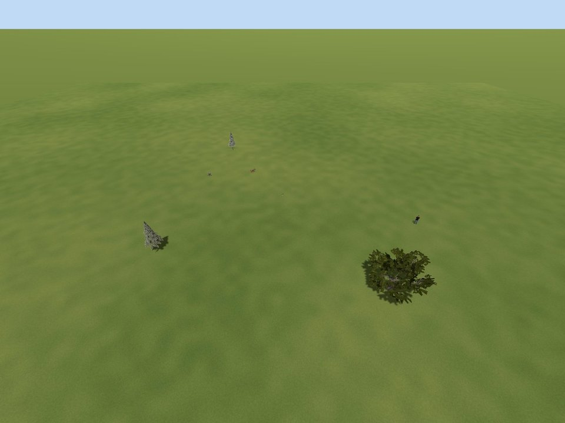
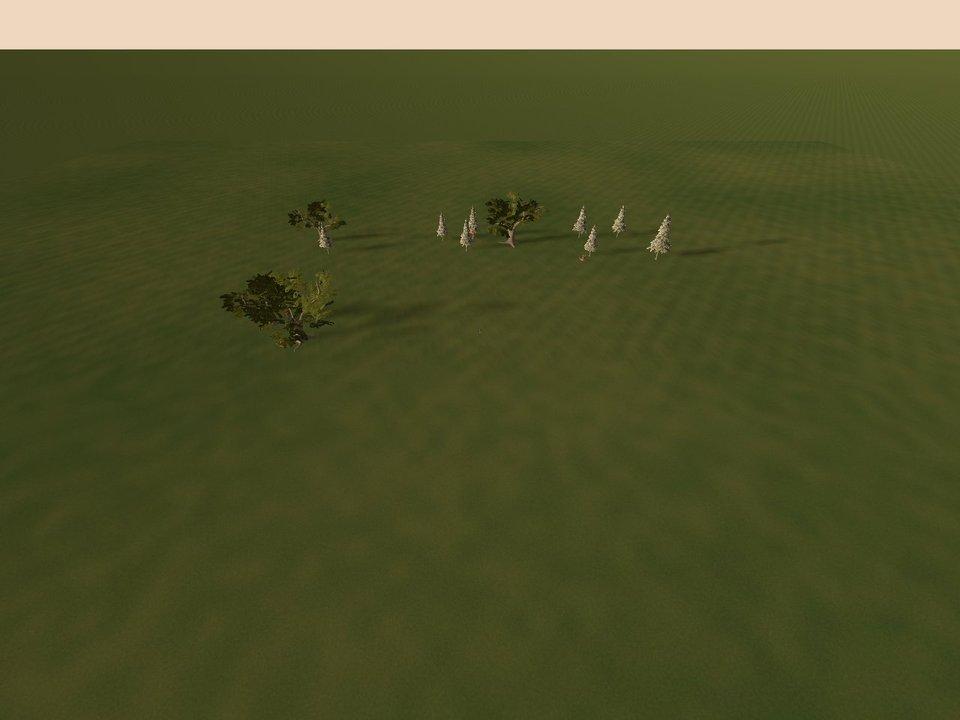
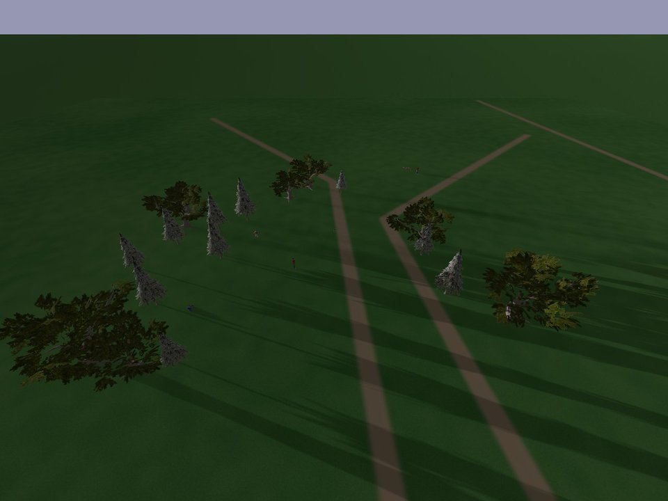
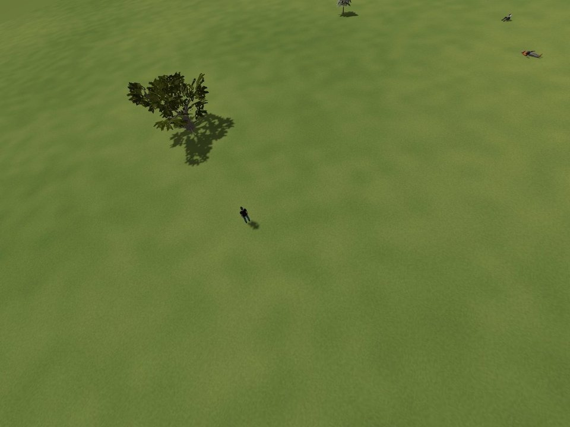
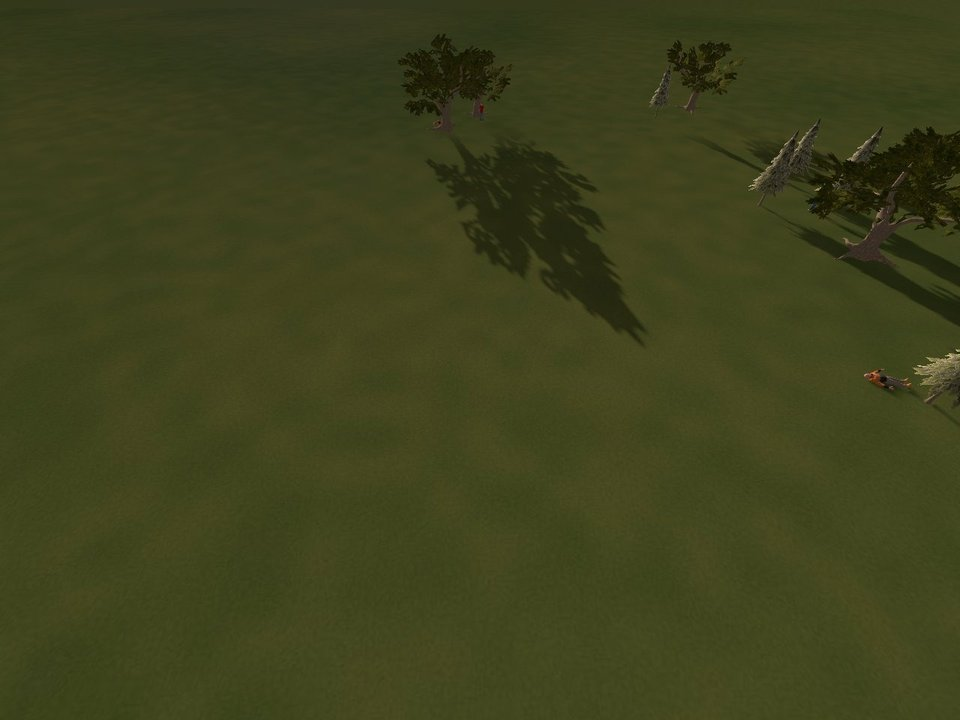
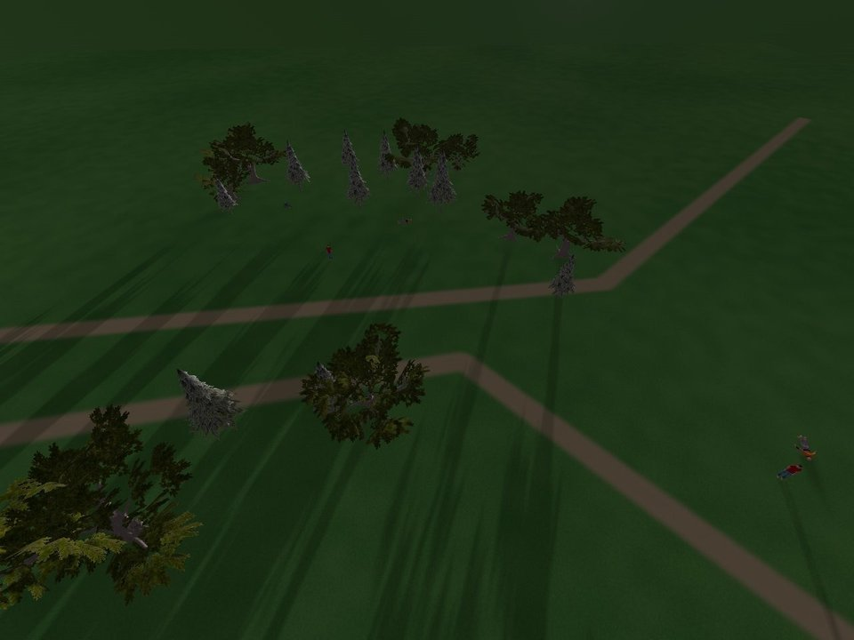
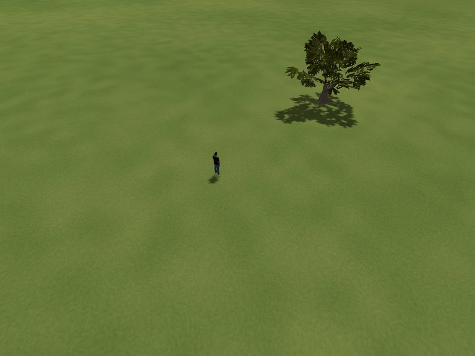
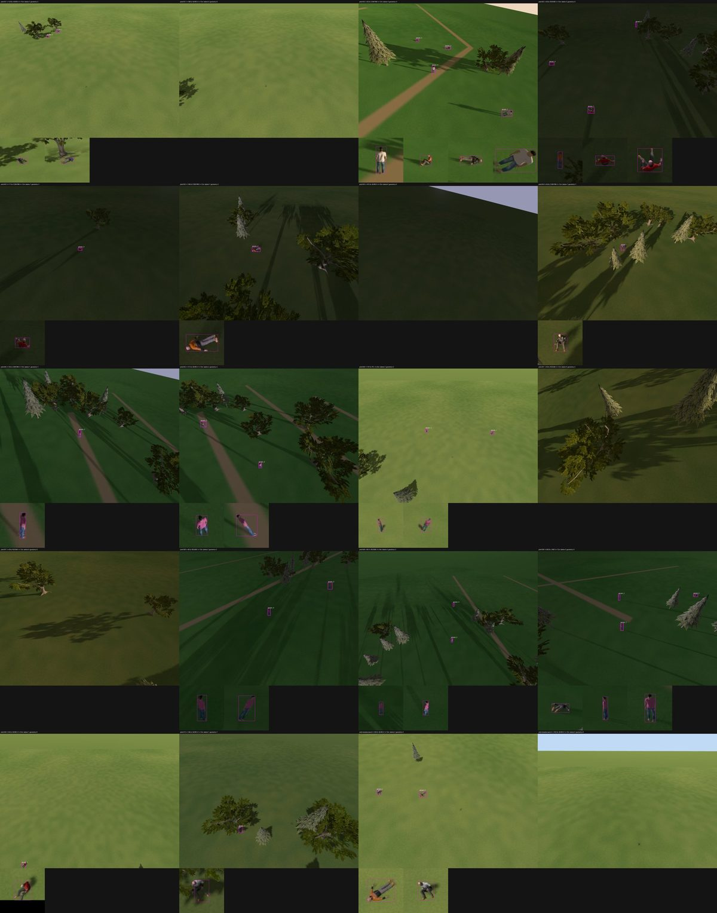

# sardrone

A search-and-rescue drone in simulation. Each flight is recorded as **one
`.mcap` file** (an "episode") plus a small JSON sidecar, and the episodes are
loaded into **FiftyOne's multimodal viewer**, where camera, GPS, pose and
events replay on a single timeline.

Week 1 built the recording and viewing pipeline. Phase 2A added generated
worlds with people in them. The full plan is in [docs/PLAN.md](docs/PLAN.md),
and [docs/DEVLOG.md](docs/DEVLOG.md) records what broke along the way.
Detection comes later.

## Quick start

```bash
make test          # create .venv, install, run the test suite (no simulator needed)
make synthetic     # write a 10 s fake episode  -> data/episodes/synthetic-0001.mcap
make record-fake   # fly the real mission with a fake drone -> data/episodes/fake-0001.mcap
make view          # load every episode into FiftyOne and open http://localhost:5151
```

`make view` installs FiftyOne on first use (about 900 MB). To record from
PX4, start the simulator in one terminal and record from another:

```bash
make sim           # PX4 SITL + Gazebo with a forward camera, headless; leave it running
```

```bash
make record        # arm, take off to 10 m, fly a 20 m square, land -> flight-NNNN.mcap
```

`make record` takes its images from the simulated camera. For the plain
drone without a camera use `make sim SIM_MODEL=gz_x500` and
`make record CAMERA=synthetic`.

`make sim` expects PX4 in `../PX4-Autopilot`; override with
`make sim PX4_DIR=/path/to/PX4-Autopilot`. See [PX4 setup](#px4-setup).

## Generated worlds (Phase 2A)

```bash
make assets                      # download people and tree models (45 MB, once)
make preview ROW=pilot-meadow    # build the world and render it from fixed cameras
```

```bash
make sim-world ROW=pilot-meadow  # Gazebo on that world + PX4; leave it running
```

```bash
make record-world ROW=pilot-meadow
```

A row of [configs/pilot.yaml](configs/pilot.yaml) names a world type, a seed,
the number of people, their poses, occlusion, time of day and altitude. The
generator turns it into `data/worlds/<id>/` holding `world.sdf` (the Gazebo
world), `spec.json` (every object's exact pose, which is the ground truth)
and the drone model with its camera pitched 45 degrees down.

| | Meadow, noon | Forest edge, golden hour | Park, dusk |
| --- | --- | --- | --- |
| Overview |  |  |  |
| From the drone |  |  |  |

- **Seeded.** The same row gives byte-identical files, so any episode's
  world can be rebuilt.
- **Ground truth.** Each person's 3D box is written to `/ground_truth/people`
  in the episode and to the sidecar.
- **What is really simulated.** Time of day changes the sun's angle, colour
  and strength. Fog is not rendered by this Gazebo, so `weather` only accepts
  `clear`.
- **Assets and licences** are listed in [docs/ASSETS.md](docs/ASSETS.md).

## Search missions (Phase 2B)

```bash
make search-fake ROW=pilot-meadow   # the whole mission with a fake drone, about 2 s
```

```bash
make sim-world ROW=pilot-meadow     # then, in another terminal:
```

```bash
make search ROW=pilot-meadow
```

The drone sweeps the search area in lawnmower lanes. On a sighting it
descends, circles the spot with the camera on it, reports the person's
position, climbs back and continues. It flies home when the area is covered
or the battery drops to 30 %.

```
TAKEOFF -> SEARCH -> CONFIRM -> REPORT -> RESUME -> SEARCH ... -> RTL -> LAND -> DONE
              |          \-> RESUME (not confirmed)
              \-> RTL (battery low, or area covered)
```

Lane spacing comes from the camera, not from a guess:

| Altitude | Image centre looks ahead | Swath | Person in image centre | 120 m square needs |
| --- | --- | --- | --- | --- |
| 15 m | 15 m | 50 m | 43 px | 4 lanes |
| 25 m | 25 m | 84 m | 26 px | 2 lanes |
| 40 m | 40 m | 103 m (resolution-limited) | 16 px | 2 lanes |

One real flight on `pilot-meadow` (PX4 SITL, 216 s): 3 of 3 people sighted,
confirmed and reported, with 17 state transitions on the event timeline.
Below, a frame from a confirmation orbit; the person is near the centre.



**Sightings come from an oracle, not a detector.** Until Phase 3 there is no
model, so `sardrone.mission.oracle` reads the simulator's ground truth and
the sidecar says `detector: oracle`. This shows the flying logic works. It
does not show that people can be found in images, and the reported position
errors (0.2 to 0.9 m) are optimistic for the reason given in the dev log.

## Batches (Phase 2C)

```bash
make batch MATRIX=configs/pilot10.yaml        # unattended; starts and stops the simulator
```

```bash
make batch-fake MATRIX=configs/pilot10.yaml   # same bookkeeping, fake drone, seconds
```

For each row the batch generates the world, flies the search and appends a
line to `data/episodes/<matrix>.manifest.csv` with the outcome, the seed,
the matrix row and the git commit. Stop it and run it again: finished
episodes are skipped.

The ten-episode pilot ran unattended in 43.8 minutes: 10 of 10 completed,
30 of 30 people reported (by the oracle), 22,881 frames, 1.89 GB. Its
manifest is in [docs/results/pilot10.manifest.csv](docs/results/pilot10.manifest.csv).

## Labelled frames (Phase 2D)

```bash
make frames     # pictures at 2 per second from every episode -> FiftyOne "sar-frames"
```

```bash
make overlay    # 20 random frames with their boxes drawn -> data/overlays/
```

Labels are free in simulation, if they are exact. The drone carries a second
sensor in the same place as its camera: Gazebo's bounding-box camera, which
reports a pixel rectangle around the visible part of every person. Picture
and boxes are rendered at the same instant, so a person hidden by a tree
simply has no box.

The pilot batch gives 4,678 frames with 6,355 person boxes (median 30 px on
the longer side). Twenty random overlays:



Each frame also stores how many people geometry says should be in view. In
open terrain that matches the label count in 92.6 % of frames; under trees
only 63.3 %, because the labels (correctly) leave out people the canopy
hides.

## What is verified, and what is not

| Part | Status |
| --- | --- |
| Time and frame conversions, `EpisodeWriter`, synthetic episode | Tested (`make test`), files read back with an independent MCAP reader |
| Mission logic in `record_flight.py` | Tested end to end with `FakeDrone` on simulated time |
| FiftyOne dataset + App | Tested; viewer checked by hand: 3D, camera, map and log tiles replay with no warnings |
| `MavsdkDrone` against a running PX4 | Flown on PX4 SITL v1.18 + Gazebo Harmonic (`gz_x500`, headless), from a cold start. Not part of `make test`, which must run without a simulator |
| Gazebo camera | Byte protocol and `GazeboCamera` tested without a simulator (stand-in bridge). Flown once on `gz_x500_mono_cam`, headless: 591 frames at 1280x960, checked in FiftyOne |
| World generator | Tested without Gazebo (54 tests). Three pilot worlds rendered and flown on PX4; pictures above are from those runs |
| Ground-truth boxes | In the file and the sidecar. Projected into frames with PX4's estimated pose they land 20 to 40 px off the people; exact image labels are Phase 2D |
| Coverage planner | Tested: every sample point of rectangles, triangles, tilted and L-shaped areas is covered, at four lane headings |
| Search state machine | Tested with `FakeDrone`: find-all, nobody seen, false alarm, low battery, illegal transition. One real PX4 flight found 3 of 3 with the oracle. Low battery was not tried on PX4 |
| Batch runner | Bookkeeping tested with a stand-in runner (resume, retry, timeout, disk limit). One real batch of 10 completed with no failures, so retry and timeout have not been exercised against the simulator |
| Image labels | From Gazebo's bounding-box sensor. Reader, dataset and overlay code tested; 20 random overlays from the real batch checked by eye; box counts cross-checked against geometry on all 4,678 frames |
| Person detection | Not implemented. The `person_seen` event is still scripted from the drone's position; the default Gazebo world has no person in it |
| Gazebo window (GUI) | Not tried: it needs XQuartz, which needs an admin password to install |

Numbers from the recorded real flight (`flight-0001`, 61.6 s): cruise height
9.6 to 10.1 m, top ground speed 3.1 m/s, square corners within the 1 m
tolerance, touchdown 0.5 m from the takeoff point, samples every 0.10 s on
PX4's own clock, battery reported on a 0 to 100 scale.

## Layout

| Path | Purpose |
| --- | --- |
| `sardrone/mcap/timeutil.py` | Integer-nanosecond time, `ns_to_ts`, `safe_ts`, `EpisodeClock` |
| `sardrone/mcap/frames.py` | NED/FRD (PX4) to ENU/FLU (Z-up) for positions and quaternions |
| `sardrone/mcap/geo.py` | Metres from home to latitude/longitude and back |
| `sardrone/mcap/episode_writer.py` | `EpisodeWriter`: channels, schemas, sidecar |
| `sardrone/sim/camera.py` | `CameraSource` interface, `SyntheticCamera`, `GazeboCamera` |
| `sardrone/sim/gz_image_bridge.py` | Helper run by Gazebo's own Python; pipes camera frames to `GazeboCamera` |
| `sardrone/sim/drone.py` | `Drone` interface, `DroneState`, `FakeDrone` |
| `sardrone/sim/mavsdk_drone.py` | `MavsdkDrone`: the PX4 implementation |
| `sardrone/sim/record_flight.py` | The mission and the 10 Hz recorder |
| `sardrone/sim/synthetic.py` | Fake 10 s circle episode |
| `sardrone/sim/launch.py` | Starts Gazebo on a generated world and attaches PX4 |
| `sardrone/worlds/matrix.py` | The variation matrix (YAML) and its validation |
| `sardrone/worlds/layout.py` | Seeded placement of trees and people; ground-truth boxes |
| `sardrone/worlds/sun.py` | Time of day to sun direction and light |
| `sardrone/worlds/assets.py` | Model download, clothing recolouring, ground texture |
| `sardrone/worlds/sdf.py` | Writes the world and drone model as SDF |
| `sardrone/worlds/generate.py`, `preview.py` | CLI: build a world; render it without flying |
| `sardrone/mission/footprint.py` | What the tilted camera sees: swath, slant range, person size in pixels |
| `sardrone/mission/coverage.py` | Lawnmower lanes over a search polygon |
| `sardrone/mission/projection.py` | Map point to pixel; pixel to ground |
| `sardrone/mission/oracle.py` | Stand-in detector that reads ground truth |
| `sardrone/mission/search.py` | The search state machine and its CLI |
| `sardrone/batch.py` | Runs a whole matrix unattended; manifest and resume |
| `sardrone/mcap/reader.py` | Reads labelled frames back out of an episode |
| `sardrone/fo/frames.py` | Builds the `sar-frames` image dataset with ground-truth Detections |
| `sardrone/fo/overlay.py` | Random frames with boxes drawn, for a human check |
| `sardrone/fo/load.py` | Builds the `sar-episodes` dataset and launches the App |
| `data/episodes/` | `.mcap` + `.json` output (git-ignored) |

```
 PX4 SITL ──MAVSDK──> MavsdkDrone ┐
                                  ├─ Drone ──> FlightRecorder ──> EpisodeWriter ──> flight-0001.mcap
             (tests)   FakeDrone ─┘               │   ▲                │             flight-0001.json
                                     CameraSource ┘   │                │
                                  EpisodeClock (one clock)   NED→ENU happens here only
                                                                       │
                                                         fo/load.py ──> FiftyOne "sar-episodes"
```

## Topics in an episode

| Topic | Schema | Encoding | Notes |
| --- | --- | --- | --- |
| `/camera/front` | `foxglove.CompressedImage` | protobuf | JPEG, 10 Hz |
| `/camera/front/calibration` | `foxglove.CameraCalibration` | protobuf | once; pinhole, no distortion |
| `/gps` | `foxglove.LocationFix` | protobuf | latitude, longitude, altitude |
| `/pose` | `foxglove.PoseInFrame` | protobuf | drone in `map`, Z up |
| `/tf` | `foxglove.FrameTransform` | protobuf | `map → base_link` and `base_link → camera_front`, every sample |
| `/events` | `foxglove.Log` | protobuf | `takeoff`, `waypoint_reached`, `person_seen`, `land`; search missions add `state`, `person_confirmed`, `person_reported`, `false_alarm`, `search_complete`, `battery_low` |
| `/telemetry` | `sardrone.Telemetry` | JSON + JSON Schema | battery, flight mode, velocity (Z up) |
| `/ground_truth/boxes` | `foxglove.ImageAnnotations` | protobuf | exact label boxes for the camera frame at the same timestamp; only with the Gazebo camera |
| `/ground_truth/people` | `foxglove.SceneUpdate` | protobuf | one 3D box per person in `map`, 1 Hz; only for generated worlds |

Every `foxglove.*` schema is protobuf, taken from the SDK's own
`msgs.X.get_schema()`. Only the custom `/telemetry` type is JSON, which
viewers accept because it is not in the `foxglove.` namespace. FiftyOne shows
it in the raw Message inspector rather than as a plot.

The sidecar (`flight-0001.json`) holds `world`, `weather`, `time_of_day`,
`mission_prompt`, `people_placed`, `people_found`, `success`, plus
`episode_id`, `start_time_ns`, `duration_s` and per-topic message counts. The
same data is embedded in the `.mcap` as a metadata record named `episode`.

## Conventions

**Time.** Everything is integer nanoseconds. `ns_to_ts()` splits into
`(sec, nsec)` only when a message is filled in. Each episode has one clock:
the recorder takes PX4's boot-relative timestamp from the first sample as the
anchor and maps every later sample with `start + (reading − anchor)`.
`safe_ts()` rejects anything before 2020, so a boot-relative or sim-relative
time can never be written as wall-clock time.

**Frames.** PX4 speaks NED (z down) with an FRD body. The episode stores ENU
(z up) with an FLU body. Callers pass PX4-native values to `EpisodeWriter`;
the conversion happens in exactly one place.

| Frame id | Meaning |
| --- | --- |
| `map` | ENU world, origin at PX4's local origin (roughly the takeoff point) |
| `base_link` | drone body, x forward, y left, z up |
| `camera_front` | optical frame: x right, y down, z into the image |

## PX4 setup

What was done on this Mac (Apple Silicon, macOS 26), following the PX4 macOS
guide:

```bash
git clone https://github.com/PX4/PX4-Autopilot.git ../PX4-Autopilot
```

```bash
cd ../PX4-Autopilot && git submodule update --init --recursive --force
```

```bash
./Tools/setup/macos.sh --sim-tools
```

```bash
brew install pkgconf
```

- The setup script installs build tools with Homebrew, a Python venv in
  `PX4-Autopilot/.venv`, and Gazebo Harmonic in
  `PX4-Autopilot/Tools/setup/macos/.pixi`.
- `pkgconf` is not installed by the script, but the build fails without it
  ("Could NOT find PkgConfig").
- The script's last step installs XQuartz and asks for your password. It is
  only needed for the Gazebo window; `make sim` runs headless without it.
  For the window: `brew install --cask xquartz`, log out and in, then
  `make sim HEADLESS=0`.

## What the first real flight taught

The first recording against PX4 completed, but the data showed three
problems that the fake drone could not reveal. Each is now handled in code:

| Seen in the data | Cause | Fix |
| --- | --- | --- |
| Cruise at 12 m, not 10 m | PX4's height estimate was still converging after boot (1.9 m on the ground) | `wait_until_ready()` also waits for the height to hold within 10 cm for 5 s |
| 10 m/s legs, 1 m overshoot | One far setpoint makes PX4 fly at its maximum speed | The setpoint is moved along each leg at 3 m/s (`_fly_leg`) |
| Landed 6 m from takeoff | Landing started while still moving | A corner counts as reached only below 0.5 m/s |

Known limits: if PX4 does not supply attitude timestamps the recorder falls
back to this computer's monotonic clock for the whole episode (still one
clock); and if a waypoint is not reached in 90 s the mission stops with a
timeout, commands a landing and saves the partial episode.

## The Gazebo camera

`make sim` starts `gz_x500_mono_cam`, the x500 with a forward camera
(1280x960, 99.7 degree horizontal field of view, 30 Hz). Other camera models
in the checkout are `x500_mono_cam_down`, `x500_depth` and `x500_gimbal`.

```
 Gazebo ──gz-transport──> gz_image_bridge.py ──pipe──> GazeboCamera ──JPEG──> EpisodeWriter
          (Gazebo's Python 3.13)                (project venv, reader thread)
```

- **Two Pythons.** Gazebo's Python bindings exist only in the Python that
  ships with Gazebo and cannot be installed into this venv. So a small helper
  runs there and pipes raw frames over stdout: one JSON line with the lens,
  then a fixed header plus pixels per frame.
- **Newest frame only.** The bridge forwards at most 10 frames per second and
  the reader keeps one, so a slow recorder never logs a queue of old images.
  An image can be up to one render interval (1/30 s) older than its pose.
- **Fail loudly.** The camera is opened before the drone arms. No image within
  15 s, a bridge that exits, or no new frame for 3 s each raise an error
  instead of silently repeating a picture.
- **Calibration from the simulator.** Field of view comes from Gazebo's
  `camera_info`, and the mount position (12 cm forward, 3 cm left)
  from the model's SDF; it is written into the `base_link → camera_front`
  transform. (Correction: the first version recorded the mount as 24 cm
  above the body. The SDF's number is from the model origin; the camera is
  2 mm above the body. Episode `flight-0002` carries the old value.)

Known limits:

- The default world is a flat grey plane, so the pictures show a horizon and
  the propellers. There is no person to see; `person_seen` is still scripted.
- Gazebo prints "Unable to load Ogre Plugin ... Rendering will not be
  possible" at startup when headless on this Mac. Images are rendered anyway.
  The cause was not found.
- `gz topic` and other Gazebo tools need `GZ_IP=127.0.0.1` on this setup,
  because PX4 runs Gazebo on the loopback interface.
- Start `make sim` from a real terminal. Without one, PX4's console prints
  its prompt endlessly.

`SyntheticCamera` remains for tests and for `make record-fake`.

## Decisions that differ from the original brief

- **`/tf` is a separate topic.** The brief put `PoseInFrame` and
  `FrameTransform` both on `/pose`; one topic with two schemas confuses
  viewers, so the transform goes on `/tf`.
- **The camera mount transform repeats with every pose.** Written once,
  FiftyOne flagged it as "Pose data is stale" a few seconds in.
- **MAVSDK 4 native API.** `pip install mavsdk` now gives v4, whose API is
  different from the gRPC package most tutorials show. The code targets v4.
- **FiftyOne's database lives in `.fiftyone/` inside this project**, and
  usage analytics are off. Export `FIFTYONE_DATABASE_DIR` yourself to use
  your normal `~/.fiftyone` instead. Launching the App still creates two tiny
  files outside the project, `~/.fiftyone/var/uid` and `welcome.json`;
  FiftyOne hard-codes that location.
- **`safe_ts()` also rejects dates after 2100**, which catches nanoseconds
  multiplied by 1000 by mistake.

## Interview talking points

- **Time:** "Each clock domain is explicit and anchored once per episode, and
  the writer validates at the boundary, so a boot-relative timestamp raises
  immediately instead of producing a 50-year timeline."
- **Frames:** "An attitude quaternion relates two frames, so converting NED to
  ENU means changing both the world and the body frame:
  `q_enu = Q_ned→enu · q · Q_frd→flu`. I test it by checking that rotating a
  vector in either convention lands on the same physical direction."
- **Schemas:** "I record with typed protobuf schemas from the SDK, so any
  Foxglove-compatible viewer can decode the file with no custom code, and my
  tests read the files back with a different MCAP library than the one that
  wrote them."
- **Sim-to-real gap:** "My fake drone passed every test, and the first real
  flight still cruised 2 m too high and overshot corners at 10 m/s. I found
  that by reading the recorded episode, which is the point of recording
  everything on one timeline."
- **Process boundary:** "The simulator's Python bindings could not be
  installed in my environment, so I put a 100-line bridge in the simulator's
  Python and defined a tiny binary protocol between them. The protocol is
  pure byte parsing, so it is unit-tested with in-memory streams and a
  stand-in bridge, with no simulator."
- **Estimate vs truth:** "I projected the simulator's ground-truth boxes
  into the images using the autopilot's pose, and they landed 20 to 40
  pixels off. The autopilot's pose is an estimate from noisy GPS and
  compass. For labels I need the simulator's true pose; for the mission I
  only ever get the estimate. Knowing which one a number comes from matters."
- **Coverage:** "My first lawnmower planner passed on a square and failed
  on a triangle: it cut each lane where its centre line left the area, so
  the slanted corners were never seen. I only found that because the test
  checks coverage on a grid of points for several shapes, instead of
  checking that the waypoints look right."
- **Altitude trade-off:** "Flying higher halves the lanes but shrinks a
  person from 43 to 16 pixels. I compute the swath from the camera model
  and cap it where a person drops below a minimum pixel size, so the
  planner refuses an altitude the detector could not use."
- **Provenance:** "Every episode has a manifest line with its seed, its
  full config and the git commit, and the batch refuses nothing but records
  whether the tree was dirty. When a number looks odd three weeks later I
  can regenerate that exact world and rerun that exact code."
- **Labels:** "My first plan was to project 3D boxes into the image with
  the drone's pose. I measured that and it was 20 to 40 pixels off. So I
  put the simulator's bounding-box sensor next to the camera: labels are
  rendered from the same view at the same instant, and occlusion is handled
  because only visible pixels count. Then I cross-checked the counts against
  geometry and looked at random overlays, because exact-looking labels that
  nobody has looked at are the classic way to train on garbage."
- **Testability:** "The mission is written against a five-method `Drone`
  interface. A fake drone with its own simulated clock lets the whole
  arm-takeoff-square-land sequence, including the timeout-and-land failure
  path, run in under a second in CI."
- **Data model:** "One sample per episode, with mission facts as filterable
  fields. That makes questions like 'show me failed foggy flights' a sidebar
  filter instead of a script."
