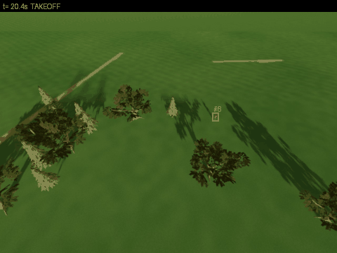
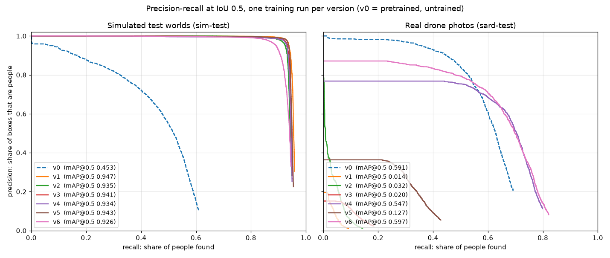

# sardrone

A search-and-rescue drone in simulation, built to practise the robotics data
loop end to end: **see → curate → embed → label → train → evaluate**, and
then measure how much of what was learned in simulation survives on real
images.

The drone flies PX4 in Gazebo, records every flight as one `.mcap` episode,
and the episodes go through FiftyOne to become a labelled dataset, a trained
detector, a scorecard, and finally a detector flying in the loop.



*A closed-loop flight. Yellow boxes are the tracker's, from the trained
detector looking at the camera image; no ground truth reaches the mission.
The drone has seen a person, descends and circles to confirm, then reports
the position.*

## What it found

**1. Training on simulation alone made the detector worse on real images
than not training it at all.**

| Version | Change | Simulated test mAP@0.5 | Real test mAP@0.5 | Gap |
| --- | --- | --- | --- | --- |
| v0 | pretrained YOLO11n, never trained on our data | 0.453 | 0.591 | -0.138 |
| v1 | fine-tuned on simulation only | 0.947 | 0.014 | 0.933 |
| v2 | v1's recipe on domain-randomized worlds | 0.935 | 0.032 | 0.902 |
| v3 | v1 + camera realism (noise, blur, JPEG, exposure) | 0.941 | 0.020 | 0.921 |
| v4 | v3 + 300 real images (5 %) | 0.934 | 0.547 | 0.387 |
| v5 | v1 with the backbone frozen | 0.943 | 0.127 | 0.816 |
| v6 | v4 with domain-randomized simulated frames | 0.926 | 0.597 | 0.329 |

The pretrained network already found half the real people. Ten epochs on
simulated frames taught it to find 93 % of simulated people and left it
nearly blind to real ones. Domain randomization (ground, light, clothing,
body size, clutter) and camera realism each left the real score near zero.
Three hundred real images restored real performance without costing
anything on simulation. Freezing the backbone kept nine times more
real-world ability than training every layer, and was still far short.
Randomization did not measurably help, alone or with real images: three
training runs each of v4 and v6 average 0.555 and 0.570 on real photos,
and each recipe's runs spread over 0.05 to 0.07. Full table with 95 % bootstrap intervals:
[docs/results/scorecard.md](docs/results/scorecard.md).

**2. No trained version beats the untrained network on real photos.** Across
three training runs each, v4 averages 0.555 and v6 0.570, against the
untrained network's 0.591; five of the six runs are below it.
On this evidence the simulated data has not been shown to help real-world
detection; what it buys is performance in the simulated worlds the drone
actually flies in (0.926 against 0.453) without losing the real-world
ability.

The precision-recall curves add a nuance the single numbers hide: on real
photos the untrained network is more precise at high confidence, but it
never finds more than 69 % of the people; v4 and v6 reach 80 % and 82 %.



Reviewing the real images that fool it: all 24 of v4's most confident
mistakes are one red car on grass. The simulated worlds have no vehicles.

**3. With the detector in the loop, the drone found 39 of 45 people** across
15 unseen simulated worlds, with no false reports. All six misses were in
forest worlds, five of them people under trees.
[docs/results/closed_loop_v4.md](docs/results/closed_loop_v4.md)
A second, lower pass over the tree cover raised that to 12 of 15 in the
five forest worlds (from 9), at the cost of one phantom reported twice,
six times as many false alarms and 2.4 times the flight time
([table](docs/results/closed_loop_v4_second_pass.md)).

**4. An off-the-shelf auto-labeller is a first draft, not a labeller.**
Scored against exact simulator labels, OWLv2 reached 90 % precision at 77 %
recall, and found 93 % of people in the open but 37 % of those under trees.
[docs/results/auto_labeler.md](docs/results/auto_labeler.md)

## How it fits together

```
 ┌─ SEE ───────────────────────────────────────────────────────────────────┐
 │ variation matrix ─> world generator ─> Gazebo + PX4 ─> search mission    │
 │  (YAML, seeded)     (trees, people,     (lawnmower, confirm, report)     │
 │                      sun, clutter)            │                          │
 │                                               ▼                          │
 │                              one .mcap per flight: camera, pose, GPS,    │
 │                              events, exact label boxes, ground truth     │
 └───────────────────────────────────────────────┬──────────────────────────┘
                                                 ▼
 ┌─ CURATE / EMBED / LABEL (FiftyOne) ─────────────────────────────────────┐
 │ frames at 2 Hz ─> CLIP embeddings ─> near-duplicates, train/val/test     │
 │                   by episode, hard-case views; OWLv2 auto-labels scored  │
 │                   against ground truth                                   │
 └───────────────────────────────────────────────┬──────────────────────────┘
                                                 ▼
 ┌─ TRAIN / EVALUATE ──────────────────────────────────────────────────────┐
 │ YOLO export + data hash ─> YOLO11n ─> sim-test and real SARD ─> scorecard│
 └───────────────────────────────────────────────┬──────────────────────────┘
                                                 ▼
            detector + tracker back in the mission loop ─> mission metrics
```

The same loop at three sizes:

| Stage | Smallest version that works | This project | Production |
| --- | --- | --- | --- |
| See | A folder of images | 86 simulated flights as MCAP episodes, with a manifest (seed, config, commit) per flight | A fleet's logs in object storage, indexed |
| Curate | Look through the images | Embeddings, near-duplicate tagging, hard-case views, splits by episode | Mining across millions of scenes, scenario taxonomies |
| Label | Draw boxes by hand | Exact labels from the simulator; an auto-labeller measured against them | Auto-labelling with human review queues and QA |
| Train | One notebook run | One command per version, with a data hash and a run record | Scheduled, distributed training with experiment tracking |
| Evaluate | One accuracy number | A scorecard: simulated and real test sets, bootstrap intervals, the gap | Many frozen test sets, regression gates, closed-loop simulation at scale |
| Close the loop | (none) | The detector flies 15 unseen worlds; mission metrics | Shadow mode, on-road validation |

## Run it

No simulator needed for the first three:

```bash
make test            # create .venv, install, run the test suite
```

```bash
make search-fake     # the whole search mission with a fake drone, about 2 s
```

```bash
make agent-eval      # the mission agent's 20 missions with the rule-based baseline
```

With PX4 and Gazebo installed (see [docs/DETAILS.md](docs/DETAILS.md#px4-setup)):

```bash
make assets          # people and tree models from Gazebo Fuel (45 MB, once)
```

```bash
make batch MATRIX=configs/v1.yaml     # record 75 episodes unattended (about 6 hours)
```

```bash
make frames && make curate            # labelled frames into FiftyOne, embedded and split
```

```bash
make export EXPORT=v1 && make train EXPORT=v1 VERSION=v1 && make evaluate VERSION=v1
```

```bash
make view            # open the episodes in FiftyOne's multimodal viewer
```

Every phase, with its commands and pictures, is in
[docs/DETAILS.md](docs/DETAILS.md). What broke along the way, and what each
failure taught, is in [docs/DEVLOG.md](docs/DEVLOG.md).

## The pieces

| Piece | What it does | Where |
| --- | --- | --- |
| Episodes | One `.mcap` per flight, protobuf Foxglove schemas, one clock, a JSON sidecar | `sardrone/mcap/` |
| Worlds | Seeded Gazebo worlds from a YAML row: terrain, trees, people, sun, optional randomization | `sardrone/worlds/` |
| Flying | PX4 through MAVSDK behind a small `Drone` interface, with a fake drone for tests | `sardrone/sim/` |
| Search | Camera footprint, lawnmower coverage, a state machine (search, confirm, report, return) | `sardrone/mission/` |
| Perception in flight | Trained detector, Kalman tracker with memory, mission metrics | `sardrone/mission/` |
| Batches | Whole matrices unattended, with a manifest and resume | `sardrone/batch.py` |
| Dataset | Frames, exact labels, embeddings, de-duplication, splits, auto-labels | `sardrone/fo/` |
| Training | YOLO export with a data hash, training, prediction, metrics, scorecard | `sardrone/train/` |
| Workflow | The loop as one command with a data gate for retraining | `sardrone/pipeline.py`, [docs/WORKFLOW.md](docs/WORKFLOW.md) |
| Agent | Plain-English missions to tool calls, with a 20-mission evaluation | `sardrone/agent/` |

## What is verified, and what is not

| Part | Status |
| --- | --- |
| Time and frame conversions, `EpisodeWriter`, synthetic episode | Tested (`make test`), files read back with an independent MCAP reader |
| Mission logic in `record_flight.py` | Tested end to end with `FakeDrone` on simulated time |
| FiftyOne dataset + App | Tested; viewer checked by hand: 3D, camera, map and log tiles replay with no warnings |
| `MavsdkDrone` against a running PX4 | Flown on PX4 SITL v1.18 + Gazebo Harmonic (`gz_x500`, headless), from a cold start. Not part of `make test`, which must run without a simulator |
| Gazebo camera | Byte protocol and `GazeboCamera` tested without a simulator (stand-in bridge). Flown once on `gz_x500_mono_cam`, headless: 591 frames at 1280x960, checked in FiftyOne |
| World generator | Tested without Gazebo (54 tests). Three pilot worlds rendered and flown on PX4; pictures above are from those runs |
| Ground-truth boxes | In the file and the sidecar. Projected into frames with PX4's estimated pose they land 20 to 40 px off the people; exact image labels are Phase 2D |
| Coverage planner | Tested: every sample point of rectangles, triangles, tilted and L-shaped areas is covered, at four lane headings |
| Search state machine | Tested with `FakeDrone`: find-all, nobody seen, false alarm, low battery, illegal transition. One real PX4 flight found 3 of 3 with the oracle. Low battery was not tried on PX4 |
| Batch runner | Bookkeeping tested with a stand-in runner (resume, retry, timeout, disk limit). One real batch of 10 completed with no failures, so retry and timeout have not been exercised against the simulator |
| Image labels | From Gazebo's bounding-box sensor. Reader, dataset and overlay code tested; 20 random overlays from the real batch checked by eye; box counts cross-checked against geometry on all 4,678 frames |
| Curation | De-duplication, split and saved views tested on a hand-made dataset; threshold chosen from a sweep on the pilot data |
| Auto-labeller | Scoring code tested against numbers worked out by hand; one full run on 4,105 frames |
| Metrics | AP, precision, recall and bootstrap code tested against hand-worked numbers, and it reproduces FiftyOne's mAP on 4,105 frames |
| Detector v1 | Trained once (10 epochs, 6,000-frame sample). Scores come from `make evaluate`; the real-image pipeline was cross-checked with the untrained network |
| Detection in flight | 15 closed-loop PX4 flights with detector v4; tracker and identity logic tested with the fake drone, including a persistent false positive |
| Gazebo window (GUI) | Not tried: it needs XQuartz, which needs an admin password to install |

Numbers from the recorded real flight (`flight-0001`, 61.6 s): cruise height
9.6 to 10.1 m, top ground speed 3.1 m/s, square corners within the 1 m
tolerance, touchdown 0.5 m from the takeoff point, samples every 0.10 s on
PX4's own clock, battery reported on a 0 to 100 scale.

## Limitations

- **Simulation only.** No real drone has flown this. The closed-loop
  numbers are for simulated worlds built by the same generator as the
  training worlds.
- **Narrow simulated content.** Three body meshes, two tree models, flat
  ground. Randomizing colours, light and clutter did not change that. The real test images (tall dry grass, quarry stone, roads) look
  nothing like it, and a linear classifier on image embeddings separates
  the two domains 100 % of the time.
- **v4's real score is flattered.** Its 300 real training images and the
  real test images come from the same SARD footage. A second real dataset
  would be the honest test; none has been used.
- **Small-scale training.** Each model saw a seeded 6,000-frame sample for
  10 epochs. v4 and v6 were each trained three times; their real-image
  scores spread over 0.053 and 0.072, so differences between versions
  smaller than that are not meaningful.
  ([docs/results/seed_runs.md](docs/results/seed_runs.md)) The intervals cover the choice of test
  images, not the randomness of training.
- **No fog or rain.** This Gazebo setup does not render fog, so `weather`
  only accepts `clear`.
- **No obstacle avoidance.** Missions rely on flying above the tallest tree.
- **The tracker fragments.** People leave and re-enter the picture and the
  drone's own motion is not compensated; identity is decided by ground
  position instead.
- **The mission agent has not been run with a language model.** The
  evaluation harness and a rule-based baseline exist; the Cohere back-end
  is checked offline against the SDK's own request and response types,
  but has not called the live API.
- **The retraining gate's threshold (200 hard frames) is not tuned.**

## Licences and credits

- **This repository's code:** no licence file yet; all rights reserved by
  default until one is added.
- **Ultralytics YOLO11:** AGPL-3.0. Fine for a portfolio project; it would
  matter for a closed-source product.
- **SARD** (the real test set): Sasa Sambolek and Marina Ivasic-Kos,
  "Search and Rescue Image Dataset for Person Detection", CC BY 4.0,
  doi:10.21227/ahxm-k331. Not redistributed here; one annotated picture in
  [docs/images](docs/images/v1_on_sard.jpg) shows frames from it.
- **3D models** from Gazebo Fuel (CC0 and CC BY 4.0): see
  [docs/ASSETS.md](docs/ASSETS.md). Not redistributed here.
- **PX4-Autopilot:** BSD 3-Clause; its x500 model is referenced, not copied.
- **OWLv2:** Apache-2.0. **CLIP weights** via the FiftyOne model zoo.
- **FiftyOne:** Apache-2.0. **Foxglove SDK / MCAP:** MIT.

## More

- [docs/DETAILS.md](docs/DETAILS.md): every phase, with commands and pictures
- [docs/DEVLOG.md](docs/DEVLOG.md): what broke and what was learned
- [docs/results/](docs/results/): scorecard, closed-loop table, auto-labeller report, manifests
- [docs/WORKFLOW.md](docs/WORKFLOW.md): the loop as a pipeline, and why it is not an Airflow DAG
- [docs/TALKING_POINTS.md](docs/TALKING_POINTS.md): interview talking points
- [docs/PLAN.md](docs/PLAN.md): the plan this was built from
