# sardrone, phase by phase

The detail behind the README: what each phase added, how to run it, and
the reference material (topics, conventions, simulator setup). What broke
along the way is in [DEVLOG.md](DEVLOG.md).

## Generated worlds (Phase 2A)

```bash
make assets                      # download people and tree models (45 MB, once)
make preview ROW=pilot-meadow    # build the world and render it from fixed cameras
```

```bash
make sim-world ROW=pilot-meadow  # Gazebo on that world + PX4; leave it running
```

```bash
make record-world ROW=pilot-meadow
```

A row of [configs/pilot.yaml](../configs/pilot.yaml) names a world type, a seed,
the number of people, their poses, occlusion, time of day and altitude. The
generator turns it into `data/worlds/<id>/` holding `world.sdf` (the Gazebo
world), `spec.json` (every object's exact pose, which is the ground truth)
and the drone model with its camera pitched 45 degrees down.

| | Meadow, noon | Forest edge, golden hour | Park, dusk |
| --- | --- | --- | --- |
| Overview | 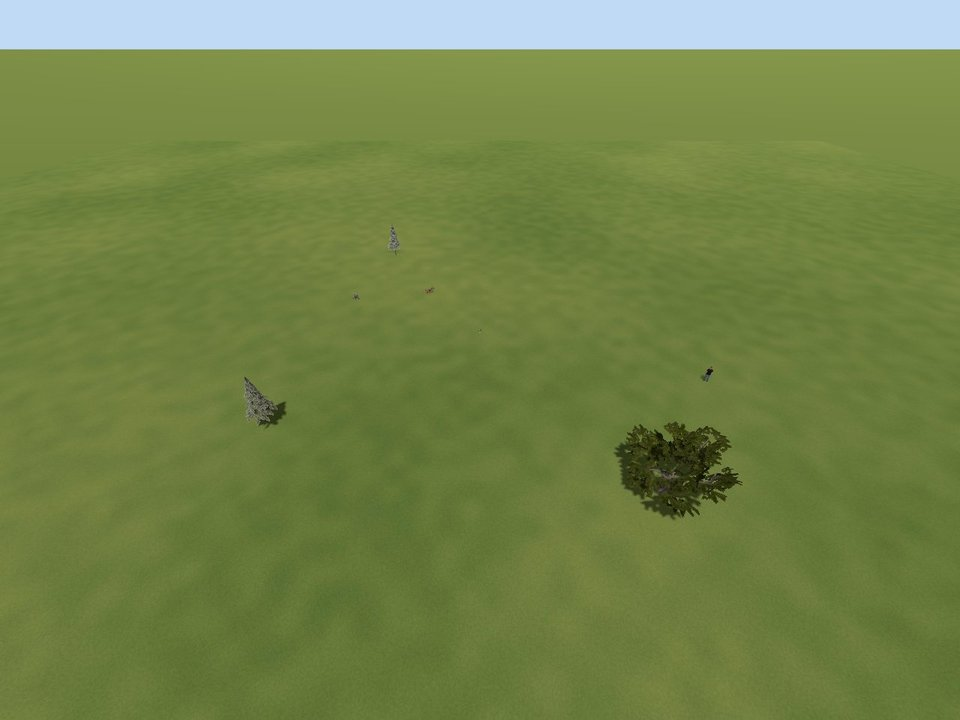 | 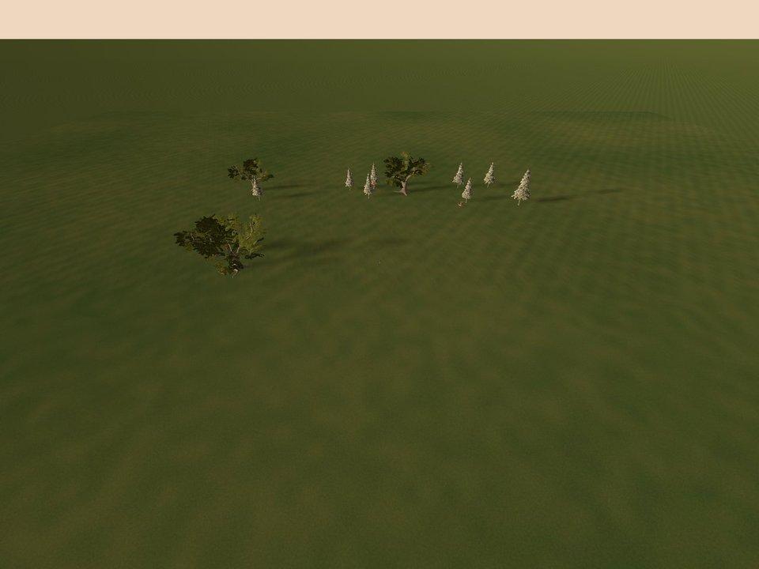 | 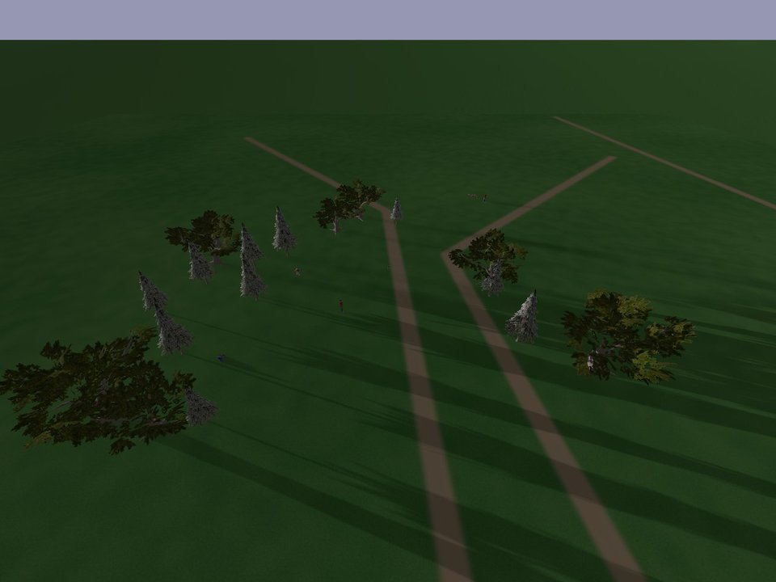 |
| From the drone | 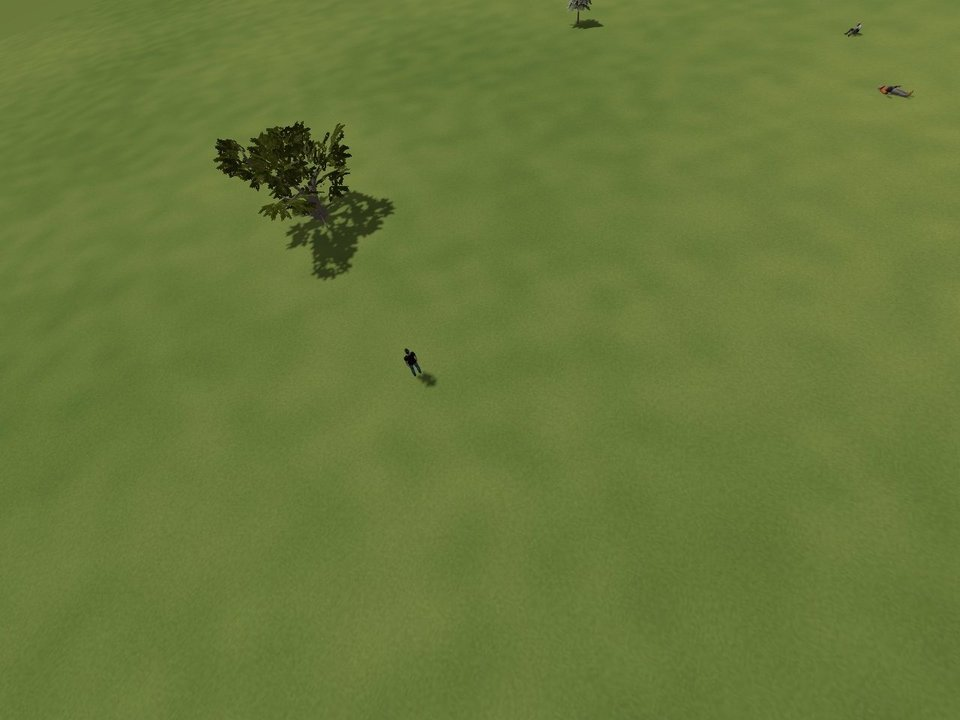 | 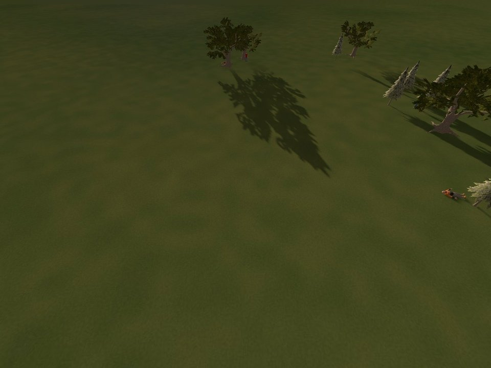 | 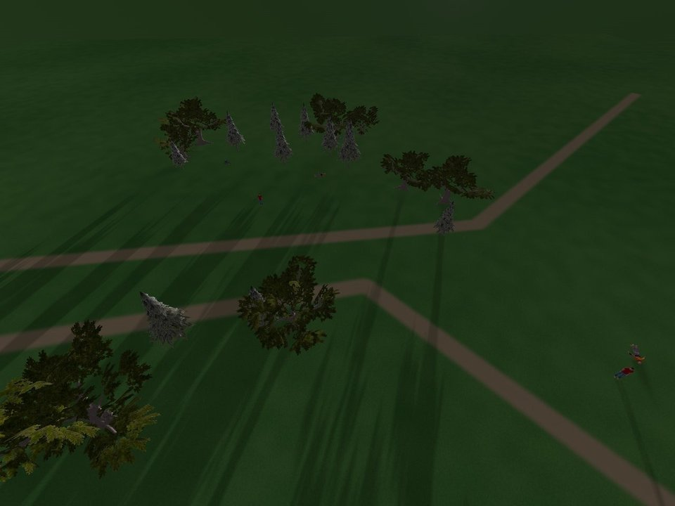 |

- **Seeded.** The same row gives byte-identical files, so any episode's
  world can be rebuilt.
- **Ground truth.** Each person's 3D box is written to `/ground_truth/people`
  in the episode and to the sidecar.
- **What is really simulated.** Time of day changes the sun's angle, colour
  and strength. Fog is not rendered by this Gazebo, so `weather` only accepts
  `clear`.
- **Assets and licences** are listed in [docs/ASSETS.md](ASSETS.md).

## Search missions (Phase 2B)

```bash
make search-fake ROW=pilot-meadow   # the whole mission with a fake drone, about 2 s
```

```bash
make sim-world ROW=pilot-meadow     # then, in another terminal:
```

```bash
make search ROW=pilot-meadow
```

The drone sweeps the search area in lawnmower lanes. On a sighting it
descends, circles the spot with the camera on it, reports the person's
position, climbs back and continues. It flies home when the area is covered
or the battery drops to 30 %.

```
TAKEOFF -> SEARCH -> CONFIRM -> REPORT -> RESUME -> SEARCH ... -> RTL -> LAND -> DONE
              |          \-> RESUME (not confirmed)
              \-> RTL (battery low, or area covered)
```

Lane spacing comes from the camera, not from a guess:

| Altitude | Image centre looks ahead | Swath | Person in image centre | 120 m square needs |
| --- | --- | --- | --- | --- |
| 15 m | 15 m | 50 m | 43 px | 4 lanes |
| 25 m | 25 m | 84 m | 26 px | 2 lanes |
| 40 m | 40 m | 103 m (resolution-limited) | 16 px | 2 lanes |

One real flight on `pilot-meadow` (PX4 SITL, 216 s): 3 of 3 people sighted,
confirmed and reported, with 17 state transitions on the event timeline.
Below, a frame from a confirmation orbit; the person is near the centre.

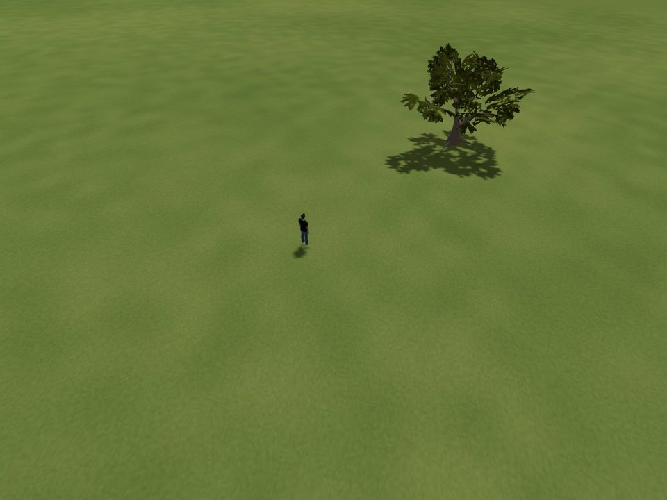

**Sightings come from an oracle, not a detector.** Until Phase 3 there is no
model, so `sardrone.mission.oracle` reads the simulator's ground truth and
the sidecar says `detector: oracle`. This shows the flying logic works. It
does not show that people can be found in images, and the reported position
errors (0.2 to 0.9 m) are optimistic for the reason given in the dev log.

## Batches (Phase 2C)

```bash
make batch MATRIX=configs/pilot10.yaml        # unattended; starts and stops the simulator
```

```bash
make batch-fake MATRIX=configs/pilot10.yaml   # same bookkeeping, fake drone, seconds
```

For each row the batch generates the world, flies the search and appends a
line to `data/episodes/<matrix>.manifest.csv` with the outcome, the seed,
the matrix row and the git commit. Stop it and run it again: finished
episodes are skipped.

The ten-episode pilot ran unattended in 43.8 minutes: 10 of 10 completed,
30 of 30 people reported (by the oracle), 22,881 frames, 1.89 GB. Its
manifest is in [docs/results/pilot10.manifest.csv](results/pilot10.manifest.csv).

## Labelled frames (Phase 2D)

```bash
make frames     # pictures at 2 per second from every episode -> FiftyOne "sar-frames"
```

```bash
make overlay    # 20 random frames with their boxes drawn -> data/overlays/
```

Labels are free in simulation, if they are exact. The drone carries a second
sensor in the same place as its camera: Gazebo's bounding-box camera, which
reports a pixel rectangle around the visible part of every person. Picture
and boxes are rendered at the same instant, so a person hidden by a tree
simply has no box.

The pilot batch gives 4,678 frames with 6,355 person boxes (median 30 px on
the longer side). Twenty random overlays:

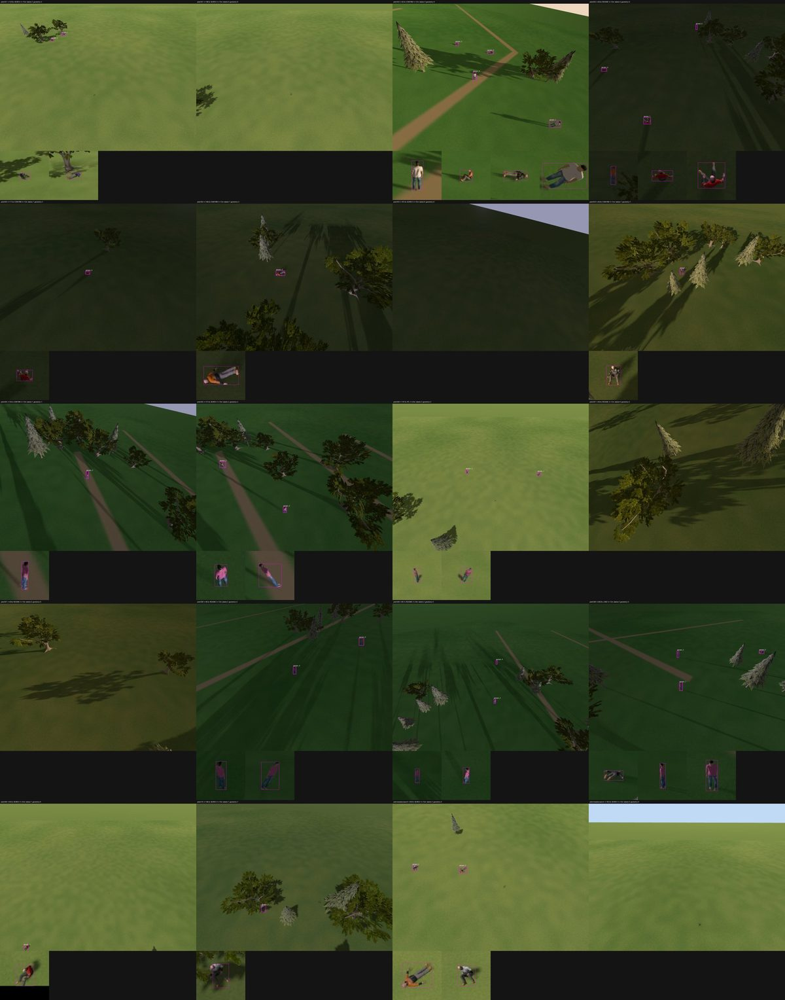

Each frame also stores how many people geometry says should be in view. In
open terrain that matches the label count in 92.6 % of frames; under trees
only 63.3 %, because the labels (correctly) leave out people the canopy
hides.

## Curate, embed, auto-label (Phase 2E)

```bash
make curate      # embeddings, 2D map, near-duplicates, train/val split, saved views
```

```bash
make autolabel   # OWLv2 auto-labels, scored against ground truth (about 35 min)
```

`make curate` embeds every frame with CLIP, tags near-duplicates, marks two
whole episodes as validation and saves the views `train-v1` (3,472 frames),
`val-v1` (633) and `sar-hard-cases` (2,480). The map below places similar
pictures close together:

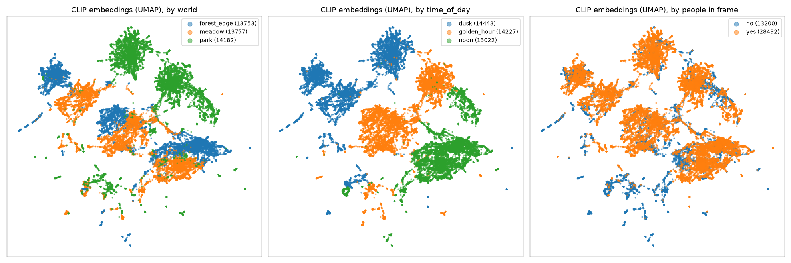

Frames group by world and lighting, not by whether a person is present: a
30-pixel person is too small to move a whole-image embedding.

`make autolabel` asks an open-vocabulary detector for people and then
measures it against the simulator's exact labels
([full report](results/auto_labeler.md)):

| Confidence at least | Precision | Recall |
| --- | --- | --- |
| 0.05 | 0.695 | 0.829 |
| 0.10 | 0.902 | 0.770 |
| 0.20 | 0.991 | 0.531 |

It finds 93 % of people in the open but 37 % of those under trees, and 49 %
of those under 16 px. Those are simulated images; the point is the method:
an auto-labeller's errors are measured before its labels are trusted.

## The detector and the sim-to-real gap (Phase 3)

```bash
make export EXPORT=v1      # saved views -> YOLO dataset with a data hash
```

```bash
make train EXPORT=v1 VERSION=v1
```

```bash
make evaluate VERSION=v1 CHANGE="baseline: simulation only"
```

The detector is Ultralytics YOLO11n (AGPL-3.0), fine-tuned from COCO
weights. It is scored on simulated worlds it never saw (`sim-test`) and on
1,387 real drone photos it never saw (`sard-test`, from SARD by Sambolek and
Ivasic-Kos, CC BY 4.0). The gap is the difference, with a 95 % bootstrap
interval. The live table is [docs/results/scorecard.md](results/scorecard.md).

| Version | Sim mAP@0.5 | Real mAP@0.5 | Gap |
| --- | --- | --- | --- |
| v0: pretrained, never trained on our data | 0.453 | 0.591 | -0.138 |
| v1: fine-tuned on simulation only | 0.947 | 0.014 | 0.933 |
| v3: v1 + camera realism (noise, blur, JPEG, exposure) | 0.941 | 0.020 | 0.921 |
| v4: v3 + 300 real images (5 %) | 0.934 | 0.547 | 0.387 |

Three findings so far. Camera realism did almost nothing. Three hundred
real images did what six thousand simulated ones could not, without
costing anything on simulation. And v4 still does not beat the untrained
network on real photos, so the simulated data has not yet been shown to
help real performance at all; the real training and test images also come
from the same footage, which flatters v4.

**The baseline result is that simulation-only training made things worse.**
The pretrained network found half the real people; after ten epochs on
simulated frames it finds 93 % of simulated people and almost none of the
real ones. Truth in magenta, v0 in cyan, v1 in yellow (v1 draws nothing):

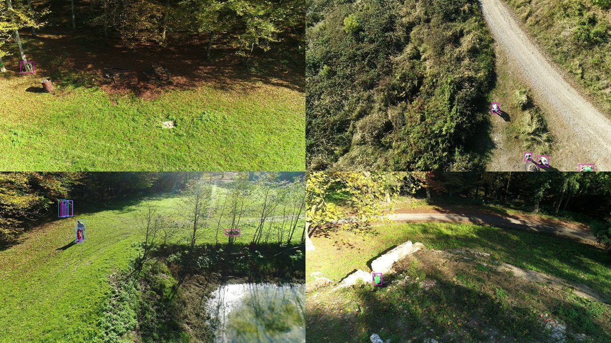

Simulated and real frames are also trivially separable as images: a linear
classifier on CLIP embeddings tells them apart 100 % of the time.

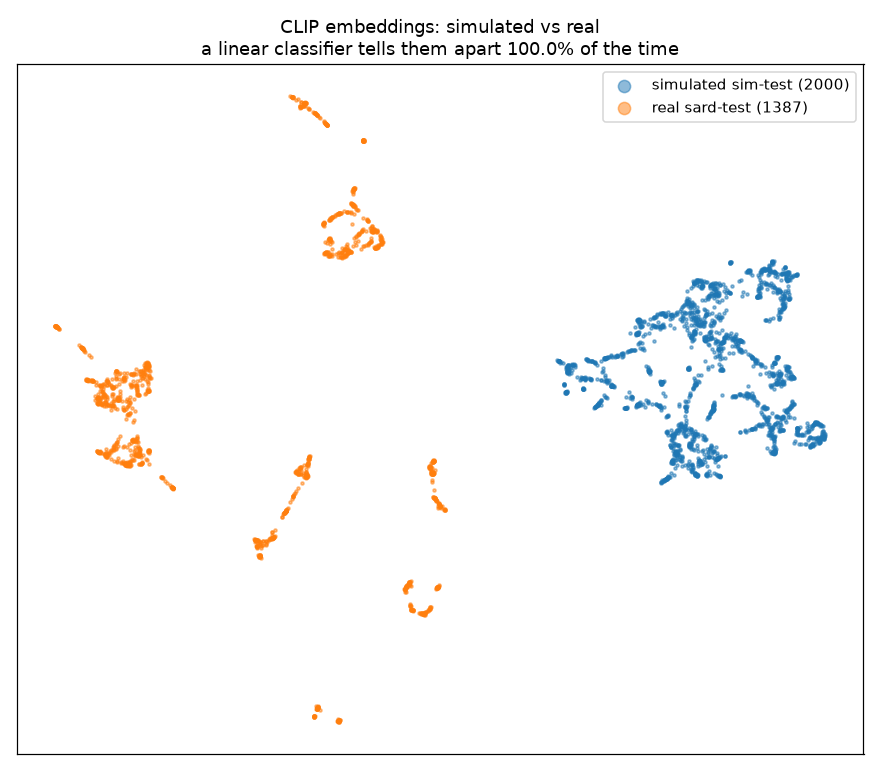

The following versions each change one thing to close the gap.

## Detection in the loop (Phase 3D)

```bash
make sim-world ROW=test-001     # then, in another terminal:
```

```bash
make search ROW=test-001 DETECTOR=v4
```

With `DETECTOR=v4` the mission no longer reads ground truth. The trained
model looks at each camera frame, a tracker (Kalman filter plus matching)
keeps identities through missed frames, and the drone acts only on tracks
it has seen three times. Ground truth is used afterwards, to score.

Fifteen sim-test worlds flown closed loop
([table](results/closed_loop_v4.md)):

| | Closed loop (v4) | Oracle |
| --- | --- | --- |
| People found | 39 of 45 | 45 of 45 |
| False reports | 0 | 0 |
| False alarms rejected by the confirmation orbit | 9 | 0 |
| Missed rescues (in view, never reported) | 6 | 0 |
| Mean flight time | 344 s | 260 s |

All six misses were in forest-edge worlds, five of them people under
trees; in the open it found 33 of 34. Nothing was reported that was not
there: nine times the detector held a false track and the orbit rejected it.

## Evaluating further (after Phase 3B)

Each of these reads predictions already stored by `make evaluate`; only
`make extra-real` runs the models again, on a new test set.

```bash
make curves                       # precision-recall curves for every version
```

```bash
make false-alarms VERSION=v4      # fills the sar-false-alarms view; contact sheet of real-photo mistakes
```

### A second real test set: HERIDAL

SARD's training pool and test set come from the same footage, which
flatters any model trained on the pool. HERIDAL is a separate set of drone
photos of people in wilderness. The copy used is Aalto University's
modified version on Zenodo (Pasi Pyrrö, CC BY 3.0,
record 5662351, one 8.3 GB file, MD5 `c2b625ae986898a870b9d8a907aefe45`).
The original HERIDAL release was academic-only on request; this copy was
licensed CC BY 3.0 by its uploader. Its own test split (101 images,
4000 x 3000) is used, and nothing from it is trained on.

Zenodo serves this file at about 180 KB/s per connection, so it was
fetched in 16 parallel byte ranges and the joined file checked against
the MD5 above. Unpack it into `data/real/heridal/`, then:

```bash
make real-voc REAL_NAME=heridal REAL_ROOT=data/real/heridal
```

```bash
make extra-real REAL_NAME=heridal VERSIONS="v0 v1 v4 v6 v7"
```

Results: `docs/results/extra_real.csv`.

### A third real test set: WiSARD (colour and thermal)

The WiSARD sample from the University of Washington's dataset site
(https://sites.google.com/uw.edu/wisard/): one search flight at Mt Erie,
264 colour (3840 x 2160) and 264 thermal (640 x 512) images, YOLO-format
labels. MIT-style licence on the site. Fetched as one zip from Google Drive
(0.97 GB; Drive refused it for a day with a download quota); MD5
`4e0c4a8678420ff6e95f894d7a7d8e8f`. Unpack into `data/real/wisard/sample/`, then:

```bash
.venv/bin/python -m sardrone.fo.yolo_real --name wisard-vis --dir data/real/wisard/sample/210417_MtErie_Enterprise_VIS_0003
```

```bash
.venv/bin/python -m sardrone.fo.yolo_real --name wisard-ir --dir data/real/wisard/sample/210417_MtErie_Enterprise_IR_0004
```

```bash
make extra-real REAL_NAME=wisard-vis VERSIONS="v0 v4 v6 v9"
```

### The agent's decisions as an episode

```bash
make agent-record MISSION=m02     # one mission, decisions on /events, viewable like a flight
```

## Topics in an episode

| Topic | Schema | Encoding | Notes |
| --- | --- | --- | --- |
| `/camera/front` | `foxglove.CompressedImage` | protobuf | JPEG, 10 Hz |
| `/camera/front/calibration` | `foxglove.CameraCalibration` | protobuf | once; pinhole, no distortion |
| `/gps` | `foxglove.LocationFix` | protobuf | latitude, longitude, altitude |
| `/pose` | `foxglove.PoseInFrame` | protobuf | drone in `map`, Z up |
| `/tf` | `foxglove.FrameTransform` | protobuf | `map → base_link` and `base_link → camera_front`, every sample |
| `/events` | `foxglove.Log` | protobuf | `takeoff`, `waypoint_reached`, `person_seen`, `land`; search missions add `state`, `person_confirmed`, `person_reported`, `false_alarm`, `search_complete`, `battery_low` |
| `/telemetry` | `sardrone.Telemetry` | JSON + JSON Schema | battery, flight mode, velocity (Z up) |
| `/ground_truth/boxes` | `foxglove.ImageAnnotations` | protobuf | exact label boxes for the camera frame at the same timestamp; only with the Gazebo camera |
| `/ground_truth/people` | `foxglove.SceneUpdate` | protobuf | one 3D box per person in `map`, 1 Hz; only for generated worlds |

Every `foxglove.*` schema is protobuf, taken from the SDK's own
`msgs.X.get_schema()`. Only the custom `/telemetry` type is JSON, which
viewers accept because it is not in the `foxglove.` namespace. FiftyOne shows
it in the raw Message inspector rather than as a plot.

The sidecar (`flight-0001.json`) holds `world`, `weather`, `time_of_day`,
`mission_prompt`, `people_placed`, `people_found`, `success`, plus
`episode_id`, `start_time_ns`, `duration_s` and per-topic message counts. The
same data is embedded in the `.mcap` as a metadata record named `episode`.

## Conventions

**Time.** Everything is integer nanoseconds. `ns_to_ts()` splits into
`(sec, nsec)` only when a message is filled in. Each episode has one clock:
the recorder takes PX4's boot-relative timestamp from the first sample as the
anchor and maps every later sample with `start + (reading − anchor)`.
`safe_ts()` rejects anything before 2020, so a boot-relative or sim-relative
time can never be written as wall-clock time.

**Frames.** PX4 speaks NED (z down) with an FRD body. The episode stores ENU
(z up) with an FLU body. Callers pass PX4-native values to `EpisodeWriter`;
the conversion happens in exactly one place.

| Frame id | Meaning |
| --- | --- |
| `map` | ENU world, origin at PX4's local origin (roughly the takeoff point) |
| `base_link` | drone body, x forward, y left, z up |
| `camera_front` | optical frame: x right, y down, z into the image |

## PX4 setup

What was done on this Mac (Apple Silicon, macOS 26), following the PX4 macOS
guide:

```bash
git clone https://github.com/PX4/PX4-Autopilot.git ../PX4-Autopilot
```

```bash
cd ../PX4-Autopilot && git submodule update --init --recursive --force
```

```bash
./Tools/setup/macos.sh --sim-tools
```

```bash
brew install pkgconf
```

- The setup script installs build tools with Homebrew, a Python venv in
  `PX4-Autopilot/.venv`, and Gazebo Harmonic in
  `PX4-Autopilot/Tools/setup/macos/.pixi`.
- `pkgconf` is not installed by the script, but the build fails without it
  ("Could NOT find PkgConfig").
- The script's last step installs XQuartz and asks for your password. It is
  only needed for the Gazebo window; `make sim` runs headless without it.
  For the window: `brew install --cask xquartz`, log out and in, then
  `make sim HEADLESS=0`.

## What the first real flight taught

The first recording against PX4 completed, but the data showed three
problems that the fake drone could not reveal. Each is now handled in code:

| Seen in the data | Cause | Fix |
| --- | --- | --- |
| Cruise at 12 m, not 10 m | PX4's height estimate was still converging after boot (1.9 m on the ground) | `wait_until_ready()` also waits for the height to hold within 10 cm for 5 s |
| 10 m/s legs, 1 m overshoot | One far setpoint makes PX4 fly at its maximum speed | The setpoint is moved along each leg at 3 m/s (`_fly_leg`) |
| Landed 6 m from takeoff | Landing started while still moving | A corner counts as reached only below 0.5 m/s |

Known limits: if PX4 does not supply attitude timestamps the recorder falls
back to this computer's monotonic clock for the whole episode (still one
clock); and if a waypoint is not reached in 90 s the mission stops with a
timeout, commands a landing and saves the partial episode.

## The Gazebo camera

`make sim` starts `gz_x500_mono_cam`, the x500 with a forward camera
(1280x960, 99.7 degree horizontal field of view, 30 Hz). Other camera models
in the checkout are `x500_mono_cam_down`, `x500_depth` and `x500_gimbal`.

```
 Gazebo ──gz-transport──> gz_image_bridge.py ──pipe──> GazeboCamera ──JPEG──> EpisodeWriter
          (Gazebo's Python 3.13)                (project venv, reader thread)
```

- **Two Pythons.** Gazebo's Python bindings exist only in the Python that
  ships with Gazebo and cannot be installed into this venv. So a small helper
  runs there and pipes raw frames over stdout: one JSON line with the lens,
  then a fixed header plus pixels per frame.
- **Newest frame only.** The bridge forwards at most 10 frames per second and
  the reader keeps one, so a slow recorder never logs a queue of old images.
  An image can be up to one render interval (1/30 s) older than its pose.
- **Fail loudly.** The camera is opened before the drone arms. No image within
  15 s, a bridge that exits, or no new frame for 3 s each raise an error
  instead of silently repeating a picture.
- **Calibration from the simulator.** Field of view comes from Gazebo's
  `camera_info`, and the mount position (12 cm forward, 3 cm left)
  from the model's SDF; it is written into the `base_link → camera_front`
  transform. (Correction: the first version recorded the mount as 24 cm
  above the body. The SDF's number is from the model origin; the camera is
  2 mm above the body. Episode `flight-0002` carries the old value.)

Known limits:

- The default world is a flat grey plane, so the pictures show a horizon and
  the propellers. There is no person to see; `person_seen` is still scripted.
- Gazebo prints "Unable to load Ogre Plugin ... Rendering will not be
  possible" at startup when headless on this Mac. Images are rendered anyway.
  The cause was not found.
- `gz topic` and other Gazebo tools need `GZ_IP=127.0.0.1` on this setup,
  because PX4 runs Gazebo on the loopback interface.
- Start `make sim` from a real terminal. Without one, PX4's console prints
  its prompt endlessly.

`SyntheticCamera` remains for tests and for `make record-fake`.

## Decisions that differ from the original brief

- **`/tf` is a separate topic.** The brief put `PoseInFrame` and
  `FrameTransform` both on `/pose`; one topic with two schemas confuses
  viewers, so the transform goes on `/tf`.
- **The camera mount transform repeats with every pose.** Written once,
  FiftyOne flagged it as "Pose data is stale" a few seconds in.
- **MAVSDK 4 native API.** `pip install mavsdk` now gives v4, whose API is
  different from the gRPC package most tutorials show. The code targets v4.
- **FiftyOne's database lives in `.fiftyone/` inside this project**, and
  usage analytics are off. Export `FIFTYONE_DATABASE_DIR` yourself to use
  your normal `~/.fiftyone` instead. Launching the App still creates two tiny
  files outside the project, `~/.fiftyone/var/uid` and `welcome.json`;
  FiftyOne hard-codes that location.
- **`safe_ts()` also rejects dates after 2100**, which catches nanoseconds
  multiplied by 1000 by mistake.

