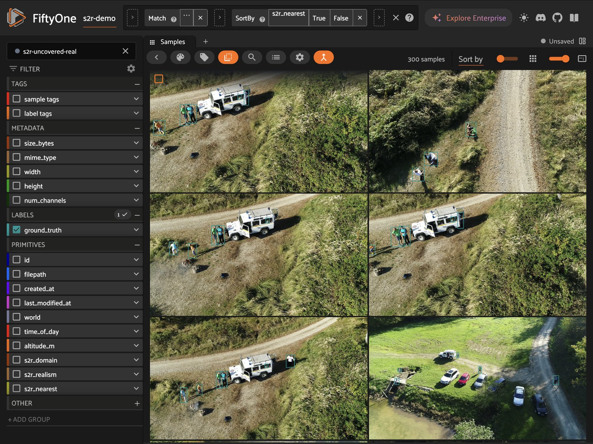
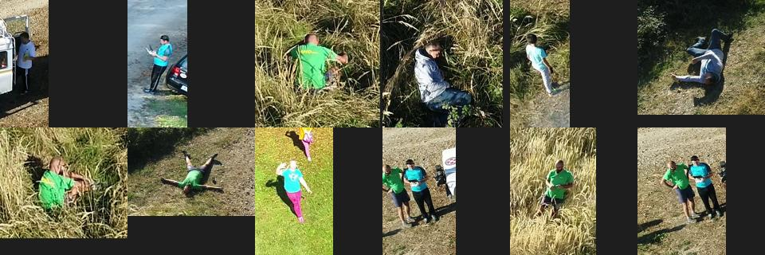
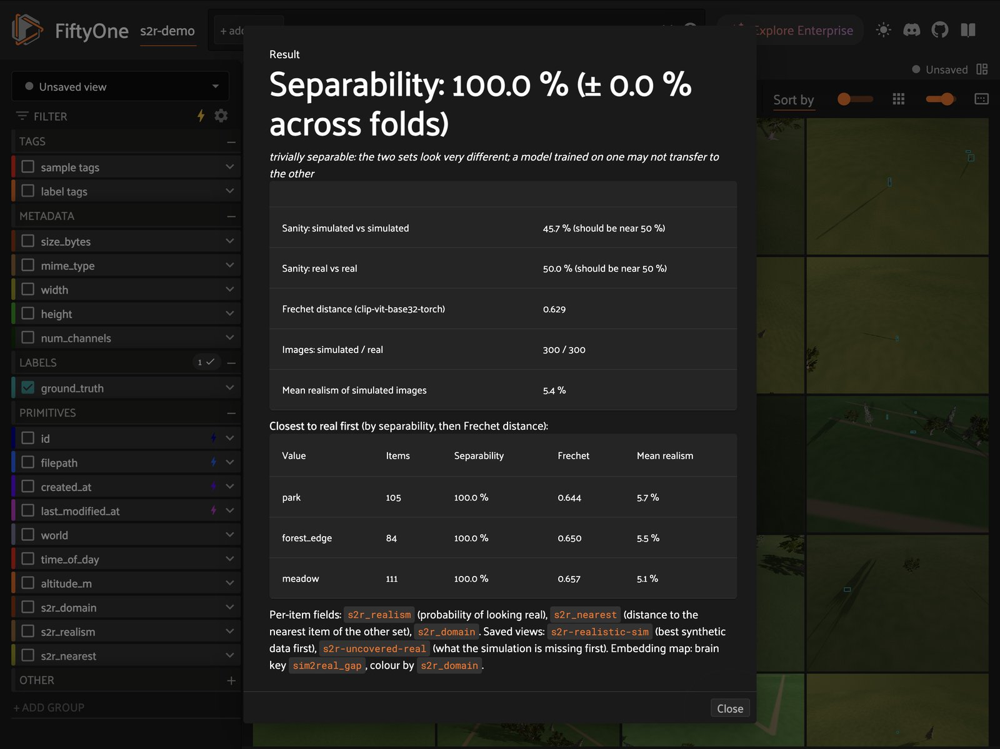
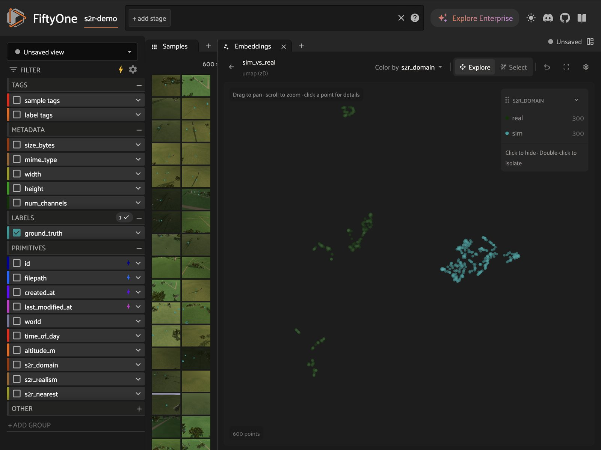

# sim2real-gap 🚁 a FiftyOne plugin

**How different are your simulated and real images, and _which_ images make
the difference?**

Training on synthetic data is cheap; finding out why it fails on real data is
not. This plugin answers, from embeddings and in minutes, before you train:

| Question | What you get |
| --- | --- |
| How big is the gap? | Separability (a classifier two-sample test) with its spread, two sanity checks, and a Fréchet distance |
| **What is my simulation missing?** | A view of the real images least like anything simulated |
| Which synthetic data is most useful? | A per-sample realism score, and a view of the most real-looking simulated images |
| Which simulated conditions are closest to real? | A breakdown by any field: world, weather, camera, time of day... |
| Is it the scenes, or the objects? | The same analysis on object crops (e.g. people), not just whole images |
| What does my detector get wrong? | Its most confident false alarms, or the objects it missed |

It works on two views of one dataset or on **two different datasets**, with
CLIP or DINOv2 embeddings (computed only where missing), in the App or from
Python, and runs as a delegated operation on big datasets.

## Example: what was a drone simulator missing?

Built for [sardrone](https://github.com/kartik-joshi/sardrone), a
search-and-rescue drone in simulation. Comparing 300 simulated frames with
300 real drone photos (SARD):

- **Separability 100.0 %** (permutation p = 0.0099, the smallest possible
  with 100 permutations), with the 15 simulated recordings kept whole in
  every fold (`split_field="recording"`), and a Fréchet distance 0.596 above
  the same-source baselines. The sets are trivially different, and a
  detector trained on the simulated frames alone scored 0.01 mAP on the
  real photos. (Without the split field the plugin warns that 27 % of the
  simulated frames have a near-copy among them; the score is the same here
  because the gap is so large.)
- **The real images least covered by the simulation**, top of the
  `s2r-uncovered-real` view, unprompted:



  Off-road vehicles, parked cars, gravel roads, a pond, tall dry grass. None
  of them exist in the simulated worlds, and cars were also the detector's
  most confident false alarms. That is the to-do list for the simulator.

- **Object level** (person crops): at the same size as the whole images
  (150 per set, three seeds, each image's crops kept in one fold), the
  crops are 95 to 97 % separable with a Fréchet gap of about 0.20 above the
  same-source baselines, against 100 % and 0.61 for whole images
  (baselines 0.03 to 0.07).
  The simulated *people* are closer to real than the simulated *scenes*. Real people the simulation never shows: in tall grass, on
  gravel, in groups, next to vehicles.



*Real photos above: SARD, "Search and Rescue Image Dataset for Person
Detection" (Sambolek and Ivasic-Kos), CC BY 4.0, doi:10.21227/ahxm-k331.*

The separability score means "these sets look different", not "this one is
simulated": two real drone datasets from different footage (SARD vs
HERIDAL) were 98 % separable too.

## Install

```bash
fiftyone plugins download https://github.com/kartik-joshi/sardrone/tree/main/plugins/sim2real_gap
```

```bash
fiftyone plugins requirements @kartik-joshi/sim2real-gap --install
```

That installs scikit-learn, umap-learn, scipy, torch and torchvision. Embeddings use the
FiftyOne Model Zoo (CLIP ViT-B/32 by default, or DINOv2 ViT-S/14), downloaded
on first use; existing embeddings are reused. Computing embeddings for
thousands of images takes a while: run the operator as a delegated operation
(`fiftyone delegated launch`) rather than waiting in the App.

The plugin is self-contained: it lives in the sardrone repository but needs
nothing else from it.

## Use it in the App

1. Show the simulated images (the current view) or save a view of them, and
   save a view of the real ones; or keep the real images in another dataset
   and use all of it (**(entire dataset)**).
2. Press the backtick key (`` ` ``) and run **Measure the sim-to-real gap**:
   pick the two sets, images or objects, a model, and optionally a field to
   break down by and a field to keep together (a recording or episode id,
   for video frames).
3. Read the report:

   

   Then:
   - open the saved view **`s2r-uncovered-real`**: what the simulation is
     missing, worst first;
   - open **`s2r-realistic-sim`**: the most real-looking synthetic images;
   - sort or filter any view by **`s2r_realism`** or **`s2r_nearest`**;
   - open the Embeddings panel, choose the brain key, colour by
     **`s2r_domain`** (the plugin sets readable colours for it unless you
     have chosen your own).

   
4. Optionally run **Review a detector's false alarms or misses** on your
   predictions, and save the result as a view.

## Use it from Python

```python
import fiftyone as fo
import fiftyone.operators as foo

dataset = fo.load_dataset("my-dataset")
result = foo.execute_operator(
    "@kartik-joshi/sim2real-gap/measure_sim2real_gap",
    ctx={"dataset": dataset, "params": {
        "sim_view": "simulated", "real_view": "real", "group_field": "weather",
    }},
)
print(result.result["report"])          # Markdown report
print(dataset.info["s2r"])              # the full summary
uncovered = dataset.load_saved_view("s2r-uncovered-real")
```

Object level: add `"level": "objects", "patches_field": "ground_truth"`.
Another dataset for the real set: add `"real_dataset": "my-real-dataset"`
(and `"real_view": "(entire dataset)"` to use all of it).
Video frames: add `"split_field": "recording"` (any field naming the clip).
The core functions are plain Python too: `gap.measure(sim_view, real_view, ...)`.

## What the numbers mean

| Output | Meaning | How it is computed |
| --- | --- | --- |
| Separability | How easily a linear classifier tells the sets apart. 50 % = alike, 100 % = trivially different | 5-fold cross-validated balanced accuracy of logistic regression on normalised embeddings (a classifier two-sample test, Lopez-Paz and Oquab, ICLR 2017). Folds never split a cluster: an image's objects, or a recording given as the split field |
| Spread across folds | How stable the score is between folds (not a confidence interval) | Standard deviation of the 5 fold scores |
| Permutation p-value | Could this separability be chance? Small = no. Above 0.05 the verdict says "not significant" | The same test with shuffled set labels, 100 times (at most 500 items per set, an equal share from every cluster); with clusters, whole clusters are shuffled. Omitted, with a note, when a set has fewer than 5 clusters |
| Sanity checks | Far from 50 % means the score is unreliable (often: few clusters, or near-duplicates split across the halves). Near 50 % is necessary, not sufficient: it does not detect near-duplicates between the sets' folds | The same test on two random halves of each set, whole clusters to each half; skipped, with a note, when a half has too few clusters |
| Near-duplicate warning | Many items with a near-copy in their own set (video frames): give a split field | Share of items whose nearest neighbour in their own set is closer than cosine distance 0.02; shown when over 20 % and no split field is given |
| Fréchet distance | A continuous size of the gap that keeps ranking when separability saturates at 100 % | Between Gaussians fitted to the two embedding sets, as in FID, on equal-sized random subsets (half the smaller set, stated in the report) |
| Baselines and excess | How much of the Fréchet distance is just small-sample bias, and how much is the gap | The same distance between two halves of the simulated set, and of the real set, at the same size; the excess is the distance minus their mean. Compare runs by the excess |
| `s2r_realism` | Probability an item belongs to the real set | Out of fold: no item is scored by a classifier that saw it |
| `s2r_nearest` | How far an item is from anything in the other set | Cosine distance to the nearest neighbour |
| Breakdown | Which values of a field are closest to real | Groups of 50 or more are ranked, all at one common size (the smallest ranked group, at most half the real set), each score the mean of 3 subsamples, the Fréchet distance as its excess over a real-vs-real baseline. Smaller groups are listed with their mean realism but not ranked, so one rare value cannot make every comparison noisy. Missing values form their own group |

## Good to know

- Separability says the sets differ, not why, and not how much a given
  detector will lose. Use the views to see why; measure the detector on real
  data to see how much.
- Near-duplicates make two sets look more different than they are:
  frames of one video, or several crops of one image, land on both sides of
  a fold and the classifier learns to recognise them. In a test with two
  sets drawn from one source (60 images of 5 crops each, ten seeds),
  item-level folds scored 62 to 71 % with p = 0.0099 every time; keeping
  images whole scored 42 to 57 % with p = 0.10 to 0.94. The sanity checks
  read near 50 % either way, so they do not catch this; the near-duplicate
  warning does. Object level
  always keeps each image's objects together; for video, give the
  recording as the **split field**.
- Small sets are noisy: with 20 images per side from one source,
  separability can land anywhere from about 30 % to 75 %. The report warns
  under 50 per side; rely on the permutation p-value there.
- If the embedding map cannot be built, the report says why and every
  score, field and saved view is kept.
- Each run replaces the previous run's fields and saved views for the same
  prefix; use another prefix to keep both.
- Set-level scores use at most 5,000 items per set (configurable); per-item
  scores are written for every item.

## Changelog

- **2.4.0**: fixes from a fourth review. Long recordings no longer crash
  the permutation test: the 500-item cap takes an equal share of every
  cluster instead of a few whole ones. Sanity halves get whole clusters,
  balanced by size. Too few clusters skip the p-value or a sanity check
  with a note instead of failing the run. The verdict says "not
  significant" when p > 0.05; group scores show their spread across
  subsamples. A near-duplicate warning when no split field is given. The
  detector review works when the App already shows a patches view, and
  counts predictions without a confidence. Two-dataset mode offers only
  split fields both datasets have. The example is re-measured with its
  recordings kept whole.
- **2.3.0**: fixes from a third review. Object level computes embeddings
  only for the boxes that lack one and never overwrites existing ones; a
  re-run at object level clears the previous run's box scores (now declared,
  so the App can filter by them). Folds, permutations, sanity halves and
  Fréchet baselines keep clusters whole: each image's objects, or a split
  field such as a recording. The App accepts the current view, and an entire
  second dataset; the plugin's own result views and fields are no longer
  offered as inputs; patches views are refused with a clear message.
- **2.2.0**: fixes from a second review. A rare group no longer shrinks
  every group comparison: groups under 50 items are listed, not ranked, and
  ranked groups are averaged over 3 subsamples. Fréchet distances come with
  same-source baselines and the excess over them. Scores are written before
  the embedding map is built, so a map failure loses nothing; the object-level
  map works with embeddings stored on the objects. torchvision added to the
  requirements.
- **2.1.0**: fixes from an independent review. Saved views and fields no
  longer mix in an earlier run's results; reviewing a second predictions
  field no longer fails. Permutation p-value; Fréchet distance and group
  comparisons at equal, stated sizes; missing group values kept; clear error
  for mixed embedding sizes; float32 embeddings; two-dataset mode offers
  only fields both datasets have; install via `fiftyone plugins requirements`.
- **2.0.0**: per-sample and per-object realism and coverage scores, saved
  views, Fréchet distance, spread across folds, breakdown by any field,
  object level, two-dataset mode, DINOv2, a Markdown report, detector misses
  as well as false alarms.
- **1.0.0**: separability, sanity checks, embedding map, false-alarm review.

## Licence

MIT, like the rest of sardrone.
