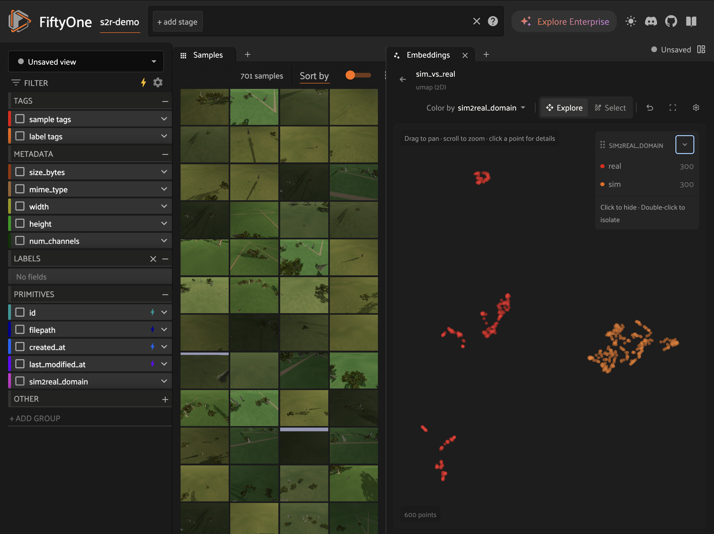
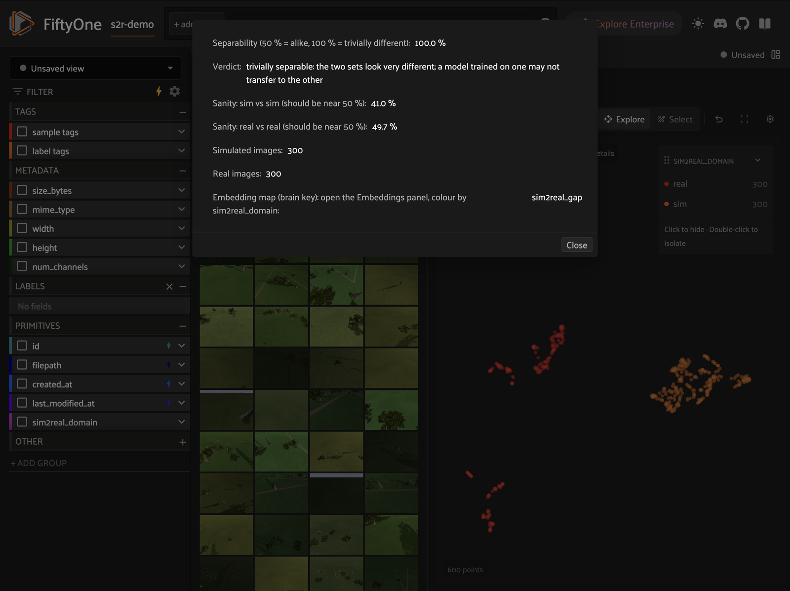
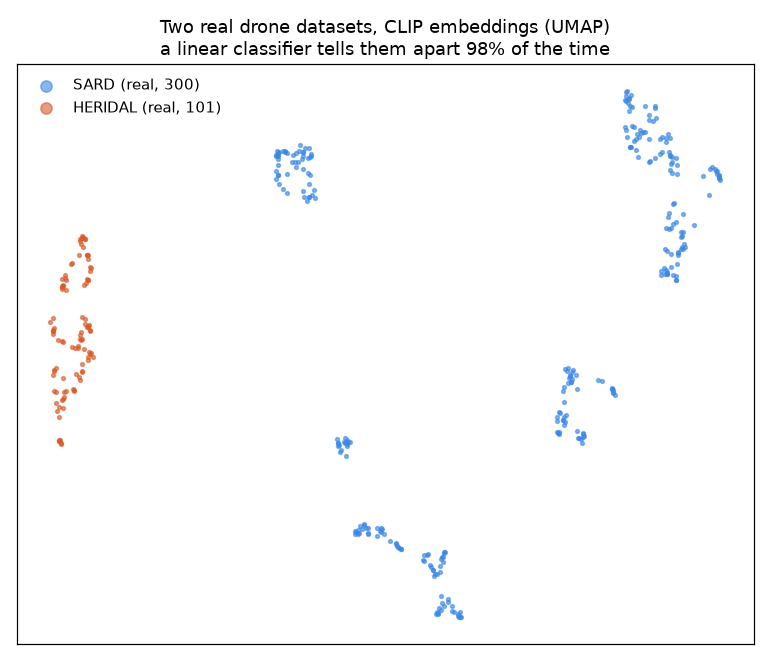

# sim2real-gap: a FiftyOne plugin

Two cheap checks before (or instead of) training on one image set and
deploying on another:

1. **How different do the two sets look?** CLIP embeddings plus a linear
   classifier asked "which set is this from?", with 5-fold cross-validation
   on balanced sets. 50 % means the sets look alike; 100 % means they are
   trivially separable. Two sanity checks (random halves of each set)
   should come out near 50 %. You also get an embedding map in the App's
   Embeddings panel, coloured by set.
2. **What does a detector mistake for its target?** A view of the
   predictions that match no ground truth, most confident first, using
   FiftyOne's own matching.

Built for [sardrone](https://github.com/kartik-joshi/sardrone), a
search-and-rescue drone in simulation, where these two checks explained why
a detector trained on simulated images failed on real ones.



*The Embeddings panel after a run: 300 simulated frames (orange) and 300 real
drone photos (red) from sardrone, coloured by `sim2real_domain`.*

## Install

```bash
fiftyone plugins download https://github.com/kartik-joshi/sardrone/tree/main/plugins/sim2real_gap
```

Needs `scikit-learn` and `umap-learn` (for the map), and the CLIP model from
the FiftyOne zoo if your samples have no embeddings yet.

## Use

Put both sets in one dataset and save a view of each (for example by tag).
Then, in the App, press the backtick key (`` ` ``) and run:

- **Measure the sim-to-real gap:** pick the two saved views. Results appear
  in the operator output and in `dataset.info["sim2real_gap"]`; open the
  Embeddings panel, choose the brain key and colour by `sim2real_domain`.
- **Review false alarms:** pick the predictions and ground-truth fields.
  The App switches to the false alarms, most confident first.



From Python:

```python
import fiftyone as fo
import fiftyone.operators as foo

dataset = fo.load_dataset("my-dataset")
result = foo.execute_operator(
    "@kartik-joshi/sim2real-gap/measure_sim2real_gap",
    ctx={"dataset": dataset, "params": {"sim_view": "sim", "real_view": "real"}},
)
print(result.result)
```

## What it found in sardrone

| Sets compared | Images | Separability | Sanity checks |
| --- | --- | --- | --- |
| Simulated (Gazebo) vs real drone photos (SARD) | 300 / 300 | 100 % | 41 %, 50 % |
| Two real drone datasets: SARD vs HERIDAL | 300 / 101 | 98 % | 50 %, 59 % |



The second row matters: two **real** datasets, from different cameras and
terrain, are nearly as separable as simulated against real. So a high score
means "these sets look different", not "this one is simulated". In
sardrone, detectors trained with SARD photos scored about 0.55 mAP@0.5 on
SARD's test photos and about 0.23 on HERIDAL's, consistent with what the
score warns about.

## Limits

- Separability says the sets differ, not why, and not how much a given
  detector will lose. Treat it as a warning light, then measure the
  detector on the second set.
- Small sets (tens of images) give noisy scores; the sanity checks show
  how noisy.
- Frames from the same video are near-duplicates: split by recording, not
  by frame, when you build the views.

## Licence

MIT, like the rest of sardrone.
