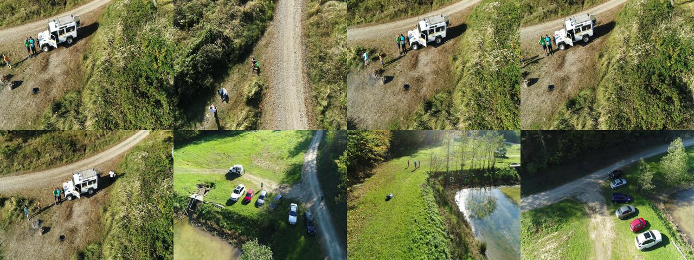

# sim2real-gap 🚁 a FiftyOne plugin

**How different are your simulated and real images, and _which_ images make
the difference?**

Training on synthetic data is cheap; finding out why it fails on real data is
not. This plugin answers, from embeddings and in minutes, before you train:

| Question | What you get |
| --- | --- |
| How big is the gap? | Separability (a classifier two-sample test) with its spread, two sanity checks, and a Fréchet distance |
| **What is my simulation missing?** | A view of the real images least like anything simulated |
| Which synthetic data is most useful? | A per-sample realism score, and a view of the most real-looking simulated images |
| Which simulated conditions are closest to real? | A breakdown by any field: world, weather, camera, time of day... |
| Is it the scenes, or the objects? | The same analysis on object crops (e.g. people), not just whole images |
| What does my detector get wrong? | Its most confident false alarms, or the objects it missed |

It works on two views of one dataset or on **two different datasets**, with
CLIP or DINOv2 embeddings (computed only where missing), in the App or from
Python, and runs as a delegated operation on big datasets.

## Example: what was a drone simulator missing?

Built for [sardrone](https://github.com/kartik-joshi/sardrone), a
search-and-rescue drone in simulation. Comparing 300 simulated frames with
300 real drone photos (SARD):

- **Separability 100.0 %** (± 0.0 % across folds; sanity checks 45.7 % and
  50.0 %): the sets are trivially different, and a detector trained on the
  simulated frames alone scored 0.01 mAP on the real photos.
- **The real images least covered by the simulation**, top of the
  `s2r-uncovered-real` view, unprompted:



  Off-road vehicles, parked cars, gravel roads, a pond, tall dry grass. None
  of them exist in the simulated worlds, and cars were also the detector's
  most confident false alarms. That is the to-do list for the simulator.

- **Object level** (person crops, 446 simulated vs 1,038 real): 97.5 %
  separable and a Fréchet distance of 0.22, against 0.63 for whole images.
  The simulated *people* are closer to real than the simulated *scenes*.
  Real people the simulation never shows: in tall grass, on gravel, in
  groups, next to vehicles.


*Real photos above: SARD, "Search and Rescue Image Dataset for Person
Detection" (Sambolek and Ivasic-Kos), CC BY 4.0, doi:10.21227/ahxm-k331.*

The separability score means "these sets look different", not "this one is
simulated": two real drone datasets from different footage (SARD vs
HERIDAL) were 98 % separable too.

## Install

```bash
fiftyone plugins download https://github.com/kartik-joshi/sardrone/tree/main/plugins/sim2real_gap
```

```bash
pip install scikit-learn umap-learn scipy
```

Embeddings use the FiftyOne Model Zoo (CLIP ViT-B/32 by default, or DINOv2
ViT-S/14), downloaded on first use. Existing embeddings are reused.

## Use it in the App

1. Save a view of each set (e.g. by tag), or keep the real images in another
   dataset.
2. Press the backtick key (`` ` ``) and run **Measure the sim-to-real gap**:
   pick the two sets, images or objects, a model, and optionally a field to
   break down by.
3. Read the report, then:
   - open the saved view **`s2r-uncovered-real`**: what the simulation is
     missing, worst first;
   - open **`s2r-realistic-sim`**: the most real-looking synthetic images;
   - sort or filter any view by **`s2r_realism`** or **`s2r_nearest`**;
   - open the Embeddings panel, choose the brain key, colour by
     **`s2r_domain`**.
4. Optionally run **Review a detector's false alarms or misses** on your
   predictions, and save the result as a view.

## Use it from Python

```python
import fiftyone as fo
import fiftyone.operators as foo

dataset = fo.load_dataset("my-dataset")
result = foo.execute_operator(
    "@kartik-joshi/sim2real-gap/measure_sim2real_gap",
    ctx={"dataset": dataset, "params": {
        "sim_view": "simulated", "real_view": "real", "group_field": "weather",
    }},
)
print(result.result["report"])          # Markdown report
print(dataset.info["s2r"])              # the full summary
uncovered = dataset.load_saved_view("s2r-uncovered-real")
```

Object level: add `"level": "objects", "patches_field": "ground_truth"`.
Another dataset for the real set: add `"real_dataset": "my-real-dataset"`.

## What the numbers mean

| Output | Meaning | How it is computed |
| --- | --- | --- |
| Separability | How easily a linear classifier tells the sets apart. 50 % = alike, 100 % = trivially different | 5-fold cross-validated balanced accuracy of logistic regression on normalised embeddings (a classifier two-sample test, Lopez-Paz and Oquab, ICLR 2017) |
| ± spread | How stable that is | Standard deviation across the folds |
| Sanity checks | Should be near 50 %; if not, the score is not trustworthy | The same test on two random halves of each set |
| Fréchet distance | A continuous size of the gap that keeps ranking when separability saturates at 100 % | Between Gaussians fitted to the two embedding sets, as in FID. Biased by set size: compare runs of similar size |
| `s2r_realism` | Probability an item belongs to the real set | Out of fold: no item is scored by a classifier that saw it |
| `s2r_nearest` | How far an item is from anything in the other set | Cosine distance to the nearest neighbour |
| Breakdown | Which values of a field are closest to real | Separability, Fréchet distance and mean realism per value |

## Good to know

- Separability says the sets differ, not why, and not how much a given
  detector will lose. Use the views to see why; measure the detector on real
  data to see how much.
- Frames from one video are near-duplicates. Split by recording, not by
  frame, or the sanity checks will come out below 50 %.
- Small sets (under a few dozen per side) give noisy scores; the spread and
  the sanity checks show how noisy.
- Set-level scores use at most 5,000 items per set (configurable); per-item
  scores are written for every item.

## Changelog

- **2.0.0**: per-sample and per-object realism and coverage scores, saved
  views, Fréchet distance, spread across folds, breakdown by any field,
  object level, two-dataset mode, DINOv2, a Markdown report, detector misses
  as well as false alarms.
- **1.0.0**: separability, sanity checks, embedding map, false-alarm review.

## Licence

MIT, like the rest of sardrone.
